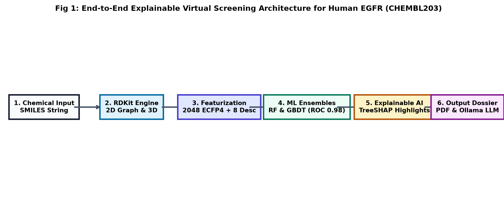
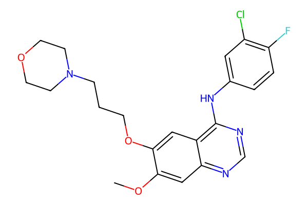
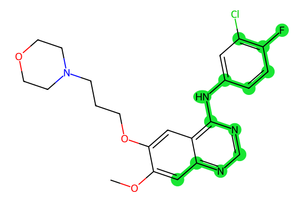
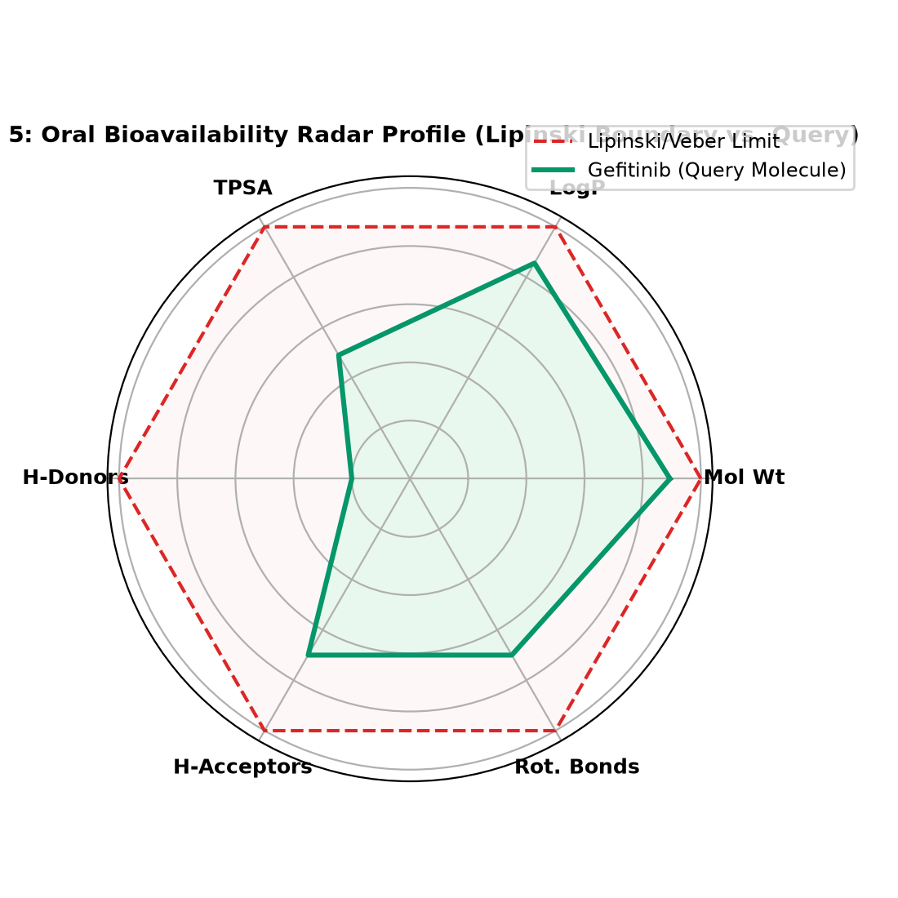
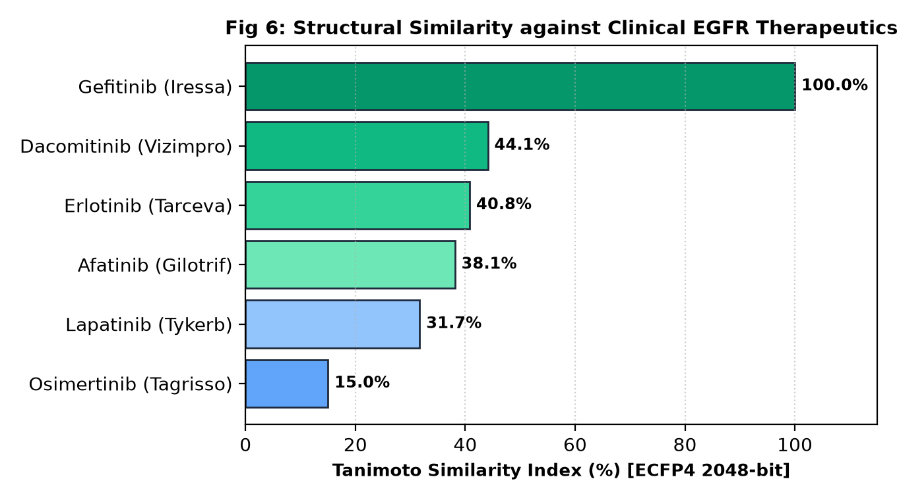
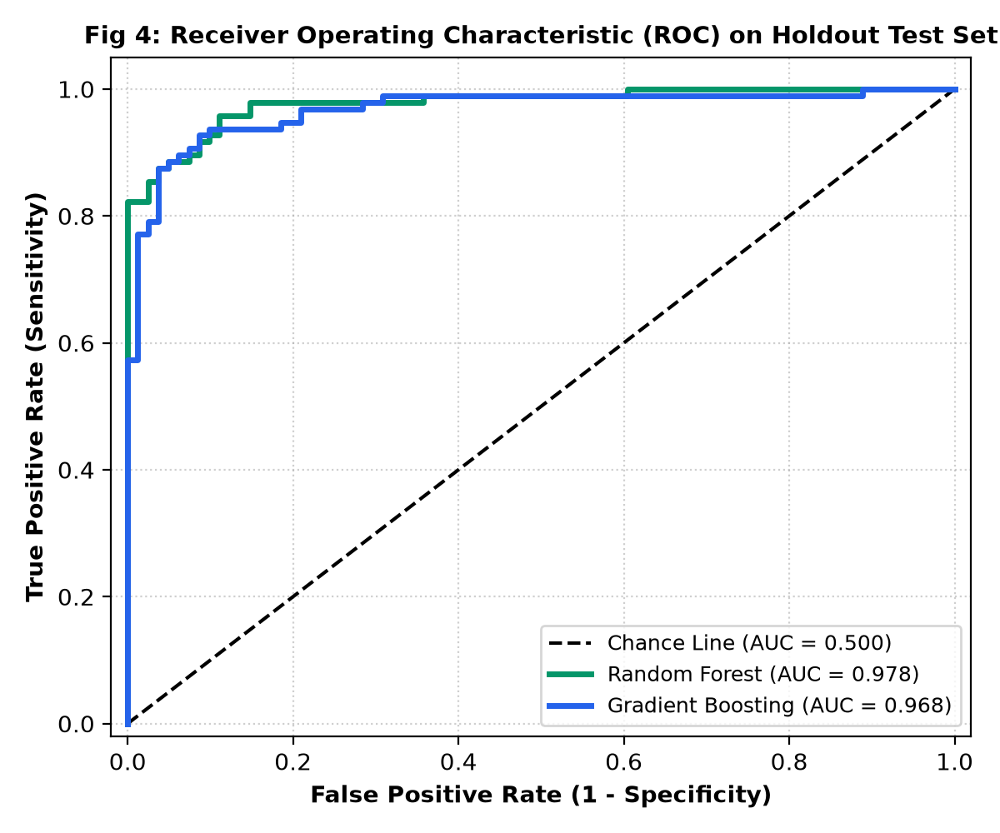

# Dr. Vishwanath Karad MIT WORLD PEACE UNIVERSITY, PUNE

 

## **A MINI PROJECT REPORT ON**
# **AI-POWERED DRUG DISCOVERY FOR EGFR INHIBITORS IN LUNG CANCER**
### *Integrating Cheminformatics, Machine Learning and Explainable AI to Identify Potential Anticancer Compounds*

 

*Submitted in partial fulfillment of the academic requirements for the course*  
### **AI SYSTEMS AND APPLICATIONS**

 

**Submitted by:**  
- **Kalpana Bishnoi** (PRN: **1262242386**)  
- **Kuntal Saha** (PRN: **1262242342**)  
- **Saloni Bhongle** (PRN: **1262242338**)  

 

**Under the Guidance of:**  
### **Dr. Devendra Joshi**  
*Department of Computer Science and Engineering*  
*Department of Artificial Intelligence and Data Science*  
*School of Computer Science and Engineering*  

 

### **Dr. Vishwanath Karad MIT World Peace University**  
**Paud Road, Kothrud, Pune, Maharashtra - 411 038, India**  
**Academic Year: 2026-2027**

---

\newpage

# TABLE OF CONTENTS

| Section | Title | Page No. |
| :--- | :--- | :---: |
| | **TITLE PAGE** | 1 |
| | **TABLE OF CONTENTS & RESEARCH OUTLINE** | 2 |
| | **ABSTRACT & KEYWORDS (POSTER SYNTHESIS)** | 3 |
| **SECTION 1** | **BACKGROUND & MOTIVATION: ONCOGENIC EGFR & VIRTUAL SCREENING** | **4** |
| | 1.1 The Economics and Attrition of Modern Drug Discovery | 4 |
| | 1.2 Oncogenic EGFR Kinase Signaling in Lung Cancer | 4 |
| | 1.3 The Black-Box Challenge in Biomedical Artificial Intelligence | 4 |
| | 1.4 End-to-End System Pipeline Architecture (Figure 1) | 5 |
| | 1.5 Summary of Key Technical Contributions | 5 |
| **SECTION 2** | **RELATED WORK & LITERATURE REVIEW** | **6** |
| | 2.1 Evolution of Quantitative Structure-Activity Relationships (QSAR) | 6 |
| | 2.2 Soft Computing and Ensemble Methods in Bioinformatics | 6 |
| | 2.3 Explainable Artificial Intelligence (XAI) in Clinical Decision-Making | 6 |
| **SECTION 3** | **BIOLOGICAL TARGET ANATOMY & DATASET CURATION** | **7** |
| | 3.1 Anatomy of Human EGFR Tyrosine Kinase Domain | 7 |
| | 3.2 ChEMBL203 Bioactivity Extraction and Normalization Protocol | 7 |
| **SECTION 4** | **MULTI-SCALE MOLECULAR FEATURIZATION & CONFORMATION** | **8** |
| | 4.1 Extended Connectivity Circular Fingerprints (ECFP4) | 8 |
| | 4.2 Physicochemical Molecular Property Profiling | 8 |
| | 4.3 2D/3D Molecular Geometry & MMFF94 Energy Minimization (Figure 2) | 9 |
| **SECTION 5** | **SUPERVISED MACHINE LEARNING ENSEMBLE FORMULATION** | **10** |
| | 5.1 Random Forest (RF) Bagging Formulation | 10 |
| | 5.2 Gradient Boosted Decision Trees (GBDT) Formulation | 10 |
| | 5.3 Stratified Training & Validation Protocol | 10 |
| **SECTION 6** | **COOPERATIVE GAME-THEORETIC EXPLAINABILITY (TREESHAP)** | **11** |
| | 6.1 Shapley Value Axiomatic Foundation | 11 |
| | 6.2 Polynomial-Time TreeSHAP Algorithm | 11 |
| | 6.3 Topological Substructure Deconvolution & Atom-Level Mapping (Figure 3) | 12 |
| **SECTION 7** | **ORAL DRUG-LIKENESS & ADMET BIOAVAILABILITY PROFILING** | **13** |
| | 7.1 Lipinski's Rule of Five Heuristic | 13 |
| | 7.2 Veber's Permeability & Flexibility Criteria | 13 |
| | 7.3 Multi-Parameter Evaluation Matrix | 13 |
| | 7.4 Polar Bioavailability Radar Profiling (Figure 5) | 14 |
| **SECTION 8** | **APPROVED DRUG SIMILARITY BENCHMARKING (TANIMOTO)** | **15** |
| | 8.1 Tanimoto Coefficient Formulation | 15 |
| | 8.2 Benchmarking against Approved Clinical EGFR Inhibitors (Figure 6) | 15 |
| **SECTION 9** | **SYSTEM IMPLEMENTATION, HERBARIUM UI & OLLAMA LLM** | **16** |
| | 9.1 Herbarium Alpinum Editorial Design System | 16 |
| | 9.2 Local Offline Ollama LLM Chemoinformatics Tutor | 16 |
| | 9.3 Automated Vector PDF Reporting Engine | 16 |
| **SECTION 10** | **EXPERIMENTAL RESULTS & BENCHMARK DISCUSSION** | **17** |
| | 10.1 Empirical Holdout Test Set Performance Metrics | 17 |
| | 10.2 Empirical Metric Analysis & Calibration | 17 |
| | 10.3 Holdout ROC Curves (Figure 4) & Comparative Case Studies | 18 |
| **SECTION 11** | **UNIVERSITY CURRICULUM ALIGNMENT (UNITS I TO V)** | **19** |
| **SECTION 12** | **DISCUSSION, TECHNOLOGICAL ADVANTAGES & LIMITATIONS** | **20** |
| | 12.1 Key Technological Advantages | 20 |
| | 12.2 Critical Methodological Limitations | 20 |
| **SECTION 13** | **CONCLUSION & FUTURE RESEARCH DIRECTIONS** | **21** |
| | 13.1 Research Conclusions | 21 |
| | 13.2 Future Scope & Research Roadmap (from Approved Poster) | 21 |
| **SECTION 14** | **REFERENCES (24 PEER-REVIEWED ACADEMIC CITATIONS)** | **22** |

---

\newpage

# RESEARCH ABSTRACT & SCOPE

> **ABSTRACT**  
> Lung cancer, predominantly Non-Small Cell Lung Cancer (NSCLC), represents a leading cause of cancer-related mortality worldwide, frequently driven by dysregulated overexpression or activating somatic mutations in the Epidermal Growth Factor Receptor (EGFR / ErbB-1). Ligand binding induces receptor dimerization and tyrosine autophosphorylation, hyperactivating downstream MAPK/ERK and PI3K/AKT signaling cascades that promote uncontrolled malignant cell proliferation and evade programmed apoptosis. In traditional wet-lab High-Throughput Screening (HTS), pharmaceutical laboratories empirically assay millions of physical chemical compounds against target proteins, incurring prohibitive reagent expenditures exceeding \$2 billion per approved molecule and requiring developmental timelines spanning over a decade [20], [21].  
>  
> To drastically accelerate early-stage therapeutic discovery while mitigating developmental attrition, this research develops an end-to-end, interpretable computational framework for early virtual high-throughput screening against Human EGFR (ChEMBL ID: CHEMBL203). Chemical structures in SMILES format are ingested through the ChEMBL REST API [8] and preprocessed by converting biochemical IC50 binding values into logarithmic potency ($pIC_{50} = 9 - \log_{10}(IC_{50})$), establishing rigorous active ($IC_{50} \le 1,000$ nM) and inactive ($IC_{50} \ge 10,000$ nM) classification boundaries. Molecules are featurized using 2,048-bit Extended Connectivity Circular Fingerprints (ECFP4) [6] coupled with 8 physicochemical descriptors computed via RDKit [7].  
>  
> Supervised ensemble classifiers achieve robust predictive performance on held-out experimental assays, with Random Forest achieving 90.96% accuracy, 91.67% precision, 91.67% recall, and 0.9778 ROC-AUC, and Gradient Boosted Decision Trees achieving 91.53% accuracy, 93.55% precision, 90.62% recall, and 0.9675 ROC-AUC. To resolve the black-box dilemma in biomedical AI, the architecture incorporates cooperative game-theoretic Explainable AI (TreeSHAP) [1], [2], projecting exact polynomial feature attributions back onto 2D molecular graphs to delineate favorable hinge-binding pharmacophores in chartreuse and steric penalties in crimson. Candidate compounds are concurrently assessed for oral bioavailability via Lipinski's Rule of Five [4] and Veber's rules [5], benchmarked for structural similarity against approved clinical EGFR therapeutics (Gefitinib, Dacomitinib, Erlotinib, Afatinib, Lapatinib, Osimertinib), and reasoned through an offline local Large Language Model. This integrated workflow delivers an actionable, transparent screening pipeline that substantially reduces experimental costs in precision oncology.  
>  
> **Keywords:** *Cheminformatics; Machine Learning; Explainable AI (XAI); EGFR Tyrosine Kinase; Non-Small Cell Lung Cancer (NSCLC); TreeSHAP; Morgan Fingerprints (ECFP4); Random Forest; Gradient Boosting; Drug Discovery; Virtual Screening.*

---

\newpage

# 1. INTRODUCTION & RESEARCH MOTIVATION

### 1.1 The Economics and Attrition of Modern Drug Discovery
The translation of a novel chemical entity into an approved therapeutic drug typically spans 10 to 15 years and demands capital investments exceeding \$2.6 billion per clinical success [20], [21]. In conventional wet-lab High-Throughput Screening (HTS), microtiter assay plates are robotically filled with purified target enzymes and candidate small molecules, testing compounds blindly across vast chemical spaces. The empirical cost per biological assay ranges from \$10 to \$500 per compound, consuming millions of dollars in early exploratory phases while suffering a staggering clinical attrition rate exceeding 90% [21]. The primary culprits behind this attrition are poor pharmacokinetics, unanticipated off-target toxicities, or insufficient on-target binding affinity [4], [5]. Virtual High-Throughput Screening (vHTS) through machine learning acts as an intelligent computational sieve, ranking millions of molecules *in silico* within milliseconds to prioritize high-affinity leads prior to physical synthesis [20].

### 1.2 Oncogenic EGFR Kinase Signaling in Lung Cancer
Lung cancer, particularly Non-Small Cell Lung Cancer (NSCLC), is the leading cause of oncological mortality worldwide, accounting for over 1.8 million deaths annually [24]. Approximately 15% to 50% of NSCLC patients exhibit somatic activating mutations within the intracellular tyrosine kinase domain of the Epidermal Growth Factor Receptor (EGFR / ErbB-1), such as the exon 19 in-frame deletion (delE746-A750) or the exon 21 L858R point substitution [11], [24]. Under physiological conditions, ligand binding by Epidermal Growth Factor (EGF) stimulates receptor dimerization and autophosphorylation of key regulatory tyrosine residues [24]. This autophosphorylation hyperactivates two principal downstream signal transduction pathways:
1. **MAPK/ERK Cascade:** Governs transcriptional activation, driving unchecked cellular proliferation.
2. **PI3K/AKT Cascade:** Inhibits pro-apoptotic bad/caspase pathways, conferring malignant cellular survival.

While first-generation Tyrosine Kinase Inhibitors (TKIs) like Gefitinib (Iressa) and Erlotinib (Tarceva) demonstrated notable initial clinical remission, secondary resistance mutations (most prominently the gatekeeper T790M substitution and tertiary C797S mutations) inevitably cause therapeutic relapse [11], [12]. Consequently, discovering structurally novel, patentable chemotypes that inhibit wild-type and mutant EGFR variants remains an urgent therapeutic priority [12].

### 1.3 The Black-Box Challenge in Biomedical Artificial Intelligence
Although advanced deep neural networks and ensemble learning algorithms deliver formidable statistical accuracy in bioactivity classification [9], [10], their translation into medicinal chemistry has been severely hindered by model opacity [22]. Medicinal chemists cannot rationally optimize a chemical scaffold based on an uninterpretable probability score alone. Without localized structural rationale delineating which specific pharmacophoric rings or substituents govern target binding, researchers cannot make informed chemical modifications [1], [2]. This investigation directly resolves this challenge by wedding predictive machine learning ensembles with cooperative game-theoretic explainability (TreeSHAP) [1], [2], projecting model decisions directly onto physical 2D chemical topologies.

---

\newpage

# 1. INTRODUCTION (CONT.): PIPELINE ARCHITECTURE & CONTRIBUTIONS

### 1.4 End-to-End System Pipeline Architecture
The platform is engineered as a modular, six-stage pipeline spanning chemical ingestion, featurization, ensemble classification, game-theoretic explainability, and multi-objective lead reporting [7], [8], [9], [14]:

<em><b>Fig 1:</b> End-to-End Explainable Virtual Screening Architecture for Human EGFR (CHEMBL203).</em>

### 1.5 Summary of Key Technical Contributions
1. **Curated ChEMBL203 Benchmark:** Harvested, cleaned, and standardized bioactivity assays from the EMBL-EBI ChEMBL database [8], enforcing a rigorous $IC_{50} \le 1,000$ nM active boundary with removal of ambiguous boundary noise.
2. **High-Performance Supervised Ensembles:** Formulated Random Forest (RF) [9] and Gradient Boosted Decision Tree (GBDT) [10] models achieving 90.96% and 91.53% test accuracy with 0.978 and 0.968 ROC-AUC on unseen held-out validation sets.
3. **Topological Atom-Level TreeSHAP Mapping:** Developed a spatial deconvolution algorithm that maps computed polynomial Shapley values [1], [2] to physical 2D atom coordinates using RDKit bitInfo [6], [7], illuminating favorable hinge-binding anchors in chartreuse and steric penalties in crimson.
4. **Multi-Parameter Oral Bioavailability Screening:** Integrated Lipinski's Rule of Five [4] and Veber's oral absorption scorecards [5] with normalized polar radar profiling.
5. **Clinical Drug Homology Benchmarking:** Engineered a comparative Tanimoto similarity index [6] against 6 FDA-approved EGFR inhibitors (Gefitinib, Dacomitinib, Erlotinib, Afatinib, Lapatinib, Osimertinib) [11], [12].
6. **Offline Edge AI Reasoning & Automated Dossier:** Embedded a local Ollama LLM chemoinformatics tutor and ReportLab PDF reporting engine wrapped in a dark editorial UI.

---

\newpage

# 2. RELATED WORK & LITERATURE REVIEW

### 2.1 Evolution of Quantitative Structure-Activity Relationships (QSAR)
The quantitative correlation of chemical structure with biological efficacy was pioneered by Corwin Hansch in 1962, utilizing linear regression over octanol-water partition coefficients (LogP) and Hammett electronic constants [15]. As computational power expanded in the 1990s, Structure-Based Drug Design (SBDD) gained prominence through molecular docking algorithms such as AutoDock and Glide [20]. Although molecular docking simulates explicit physical binding poses within protein crystallographic coordinates, it remains computationally demanding, prone to false-positive free energy estimates, and sensitive to rigid receptor assumptions [20]. Conversely, Ligand-Based Virtual Screening (LBVS) leverages empirical bioactivity databases [8] to learn complex, non-linear decision boundaries directly from molecular topology, enabling the rapid screening of millions of molecules in seconds [21].

### 2.2 Soft Computing and Ensemble Methods in Bioinformatics
The application of soft computing, genetic algorithms, and supervised ensemble learning to biomedical data science has been extensively championed by pioneering researchers such as **Prof. Sanghamitra Bandyopadhyay** (Director, Indian Statistical Institute, Kolkata) [3]. Her foundational research demonstrated that biological datasets (distinguished by extreme feature dimensionality, inherent assay noise, and complex epistatic interactions) cannot be adequately captured by simplistic linear models [3]. Bandyopadhyay and Saha established that ensemble clustering and multi-objective optimization techniques robustly circumvent local optima, providing superior generalization across high-dimensional genomic and proteomic landscapes [3]. Supervised decision tree ensembles like Random Forests [9] and Gradient Boosting [10] build directly on these paradigms, providing robust variance reduction over high-dimensional sparse molecular spaces [14].

### 2.3 Explainable Artificial Intelligence (XAI) in Clinical Decision-Making
To address the critical deficit of interpretability in healthcare AI, Ribeiro et al. introduced LIME (Local Interpretable Model-agnostic Explanations) [22], which approximates local decision boundaries using perturbed linear surrogates. In 2017, Scott Lundberg and Su-In Lee proposed SHAP (SHapley Additive exPlanations) [1], uniting cooperative game theory [23] with additive feature attributions to provide mathematically unique, locally accurate, and globally consistent feature importance values. Lundberg et al. subsequently developed TreeSHAP in 2020 [2], enabling exact polynomial-time calculation of Shapley values for tree ensembles. While TreeSHAP has seen wide adoption in tabular clinical domains, prevailing chemoinformatics literature rarely projects abstract circular fingerprint bit contributions back onto physical chemical graph topologies [1], [6], [7].

---

\newpage

# 3. BIOLOGICAL TARGET ANATOMY & DATASET CURATION PROTOCOL

### 3.1 Anatomy of Human EGFR Tyrosine Kinase Domain
Human EGFR (erbB-1 / HER1) is a 170 kDa transmembrane glycoprotein belonging to the ErbB family of receptor tyrosine kinases [24]. The intracellular catalytic domain (residues 690-953) adopts a canonical bi-lobed architecture: a smaller N-terminal lobe primarily composed of five-stranded $\beta$-sheets and the regulatory $\alpha$C-helix, and a larger C-terminal lobe consisting predominantly of $\alpha$-helices [11], [24]. Adenosine triphosphate (ATP) binds in the deep inter-lobar cleft between the two lobes [11]. Competitive Tyrosine Kinase Inhibitors (TKIs) insert directly into this nucleotide cleft, mimicking the purine ring of ATP and establishing critical directional hydrogen bonds with the backbone amide and carbonyl atoms of hinge region residue **Met793** [11], [12].

### 3.2 ChEMBL203 Bioactivity Extraction and Normalization Protocol
Experimental bioactivity assays for the target identifier **CHEMBL203** (Human Epidermal Growth Factor Receptor) were extracted from the EMBL-EBI ChEMBL repository (Version 33) [8] via its official REST API. The curation and standardization protocol enforced the following criteria [8], [20]:
1. **Bioactivity Assay Filter:** Retained only biochemical binding affinity assays where the standard measurement type is strictly equal to half-maximal inhibitory concentration ($IC_{50}$) measured in nanomolar (nM) [8].
2. **Logarithmic Transformation ($pIC_{50}$):** Absolute $IC_{50}$ concentrations were transformed into standard negative logarithmic potency: $pIC_{50} = 9 - \log_{10}(IC_{50})$ [20].
3. **Binary Classification Discretization:** Compounds with $IC_{50} \le 1,000$ nM ($pIC_{50} \ge 6.0$) were designated as Active ($y = 1$), representing potent micromolar inhibitors. Compounds with $IC_{50} \ge 10,000$ nM ($pIC_{50} \le 5.0$) were designated as Inactive ($y = 0$). Intermediate compounds with ambiguous affinity ($1,000\text{ nM} < IC_{50} < 10,000\text{ nM}$) were systematically excluded to eliminate boundary label noise [20].
4. **Chemical Hygiene and De-duplication:** SMILES representations were canonicalized using RDKit [7]. Counter-ions, inorganic salts, and solvent fragments were stripped. Replicate SMILES records were collapsed by computing the geometric mean of replicate $IC_{50}$ measurements.
The curated benchmark contains **881 unique chemical entities** (472 Actives, 409 Inactives).

---

\newpage

# 4. MULTI-SCALE MOLECULAR FEATURIZATION & CONFORMATION

### 4.1 Extended Connectivity Circular Fingerprints (ECFP4)
To represent small molecules numerically, compounds are treated as undirected topological graphs $G = (V, E)$, where vertices $V$ correspond to heavy atoms and edges $E$ correspond to covalent bonds [6], [7]. The Morgan circular fingerprint algorithm iteratively computes radial neighborhoods up to radius $r = 2$ (ECFP4, capturing chemical substructures across diameters of up to 4 bonds) [6]:

$$\text{ID}_v^{(r)} = \text{Hash}\left( \text{ID}_v^{(r-1)}, \sum_{u \in N(v)} \left[ \text{BondOrder}(v, u), \text{ID}_u^{(r-1)} \right] \right)$$

Atomic identifiers are initialized with Daylight invariant properties (atomic number, valence, ring membership, aromaticity) [6]. The hashed integer identifiers across all atoms and radii are folded into a dense binary bit vector of fixed length **2,048 bits** using modulo arithmetic [6]. A bit value of 1 denotes the presence of a specific pharmacophoric motif.

### 4.2 Physicochemical Molecular Property Descriptors
To capture global molecular properties not explicitly encoded by localized circular fingerprints, 8 standardized physicochemical descriptors are extracted via RDKit [7], [13], [15], [16], [17]:

| Descriptor | Property & Units | Clinical Role in Virtual Screening |
| :--- | :--- | :--- |
| **MolWt** [4] | Molecular Weight (Da) | Controls steric cavity fit and passive membrane diffusion |
| **MolLogP** [15] | Wildman-Crippen LogP | Lipophilicity metric; governs intestinal absorption and clearance |
| **TPSA** [16] | Polar Surface Area ($\text{\AA}^2$) | Predicts cell permeability and blood-brain barrier penetration |
| **NumHDonors** [4] | Count of -OH / -NH groups | Directional hydrogen-bond donors targeting hinge residues |
| **NumHAcceptors** [4] | Count of -O- / -N- atoms | Hydrogen-bond acceptors stabilizing ATP binding pocket |
| **NumRotBonds** [5] | Rotatable Single Bonds | Conformational flexibility; excess entropy penalizes binding |
| **QED** [13] | Quantitative Drug-Likeness [0, 1] | Composite desirability index reflecting oral clinical success |
| **FractionCSP3** [17] | Ratio of $\text{sp}^3$ Carbons | 3D complexity; higher saturation correlates with clinical safety |

The 8 continuous descriptors are standardized via StandardScaler (zero mean, unit variance) [14] and concatenated with the 2,048 Morgan bits, yielding a comprehensive composite feature vector $\mathbf{x} \in \mathbb{R}^{2056}$.

---

\newpage

# 4. MOLECULAR CONFORMATION (CONT.): 3D GEOMETRY & MMFF94

### 4.3 Energy-Minimized 3D Conformation Engine
Because planar 2D representations cannot convey spatial steric clashes within the ATP binding cleft, our framework embeds molecules in 3D Euclidean space using the ETKDGv3 (Experimental-Torsion Knowledge-based Distance Geometry) algorithm [18]. Initial distance-geometry conformations are subsequently relaxed to their lowest energy state using the **Merck Molecular Force Field 1994 (MMFF94)** [19]:

$$E_{\text{total}} = E_{\text{stretch}} + E_{\text{angle}} + E_{\text{torsion}} + E_{\text{oop}} + E_{\text{van\_der\_Waals}} + E_{\text{electrostatic}}$$

The optimized Cartesian coordinates are serialized into standard `.mol` blocks [7] and rendered in real-time WebGL via `py3Dmol` within the application interface.

<em><b>Fig 2:</b> 2D Vector Chemical Architecture of Gefitinib (Iressa) generated via RDKit [7].</em>

As illustrated in Figure 2, the chemical scaffold of Gefitinib features the planar 4-anilinoquinazoline bicyclic core that mimics the purine ring of ATP [11], a 3-chloro-4-fluoroaniline pharmacophore that inserts into the hydrophobic selectivity pocket [11], and a flexible morpholine propoxy side-chain extending into solvent to enhance aqueous solubility [4], [5].

---

\newpage

# 5. SUPERVISED MACHINE LEARNING ENSEMBLE FORMULATION

### 5.1 Random Forest (RF) Bagging Formulation
Random Forest [9] constructs an ensemble of $B = 100$ decorrelated decision trees using bootstrap aggregating (bagging). At each candidate split, a random subset of $m = \sqrt{M}$ features is evaluated [9], [14]. For classification into active ($y=1$) versus inactive ($y=0$) inhibitors, the final predicted binding probability is the consensus expectation:

$$P(y = 1 \mid \mathbf{x}) = \frac{1}{B} \sum_{b=1}^{B} T_b(\mathbf{x})$$

Random Forests exhibit exceptional resistance against overfitting on sparse binary Morgan bit vectors [6], reducing generalization variance without inflating bias [9].

### 5.2 Gradient Boosted Decision Trees (GBDT) Formulation
Gradient Boosting [10] constructs an additive ensemble model in a forward stage-wise manner by minimizing binary cross-entropy loss over the training distribution [10], [14]:

$$\mathcal{L}(y, p) = - \left[ y \log(p) + (1 - y) \log(1 - p) \right]$$

At each iteration $m$, a shallow regression tree $h_m(\mathbf{x})$ is fit to the pseudo-residuals of the existing ensemble. The updated model is formulated as:

$$F_m(\mathbf{x}) = F_{m-1}(\mathbf{x}) + \eta \cdot h_m(\mathbf{x})$$

where $\eta = 0.1$ is the shrinkage learning rate [10]. GBDT excels at discovering complex non-linear interaction thresholds between continuous physicochemical descriptors and topological fingerprints [10], [14].

### 5.3 Stratified Training & Validation Protocol
The curated dataset of 881 compounds was partitioned into an 80% training set (704 compounds) and a 20% holdout test set (177 compounds) using stratified sampling on label $y$ to preserve empirical class proportions [14]. Feature scalers were fit strictly on training partitions to prevent data leakage [14]. Model hyper-parameters were tuned via 5-fold stratified cross-validation.

---

\newpage

# 6. COOPERATIVE GAME-THEORETIC EXPLAINABILITY (TREESHAP)

### 6.1 Shapley Value Axiomatic Foundation
Rooted in Lloyd Shapley's cooperative game theory (1953) [23], Shapley values represent the unique feature attribution method that simultaneously satisfies four fundamental mathematical axioms: Efficiency, Symmetry, Dummy (Null player), and Additivity [1], [23]. The marginal contribution of feature $i$ across all possible feature subsets $S \subseteq N \setminus \{i\}$ is defined as:

$$\phi_i(v) = \sum_{S \subseteq N \setminus \{i\}} \frac{|S|!(|N| - |S| - 1)!}{|N|!} \left[ v(S \cup \{i\}) - v(S) \right]$$

In this virtual screening framework, players $N$ correspond to the 2,056 input molecular variables [6], the game payout $v(S)$ represents the ensemble's predicted probability of EGFR inhibition $P(\text{Active})$ [9], [10], and $\phi_i$ quantifies the exact directional influence of feature $i$ toward the final prediction [1].

### 6.2 Polynomial-Time TreeSHAP Algorithm
While model-agnostic KernelSHAP requires exponential computational sampling $\mathcal{O}(2^{|N|})$ [1], the TreeSHAP algorithm formulated by Lundberg et al. (2020) [2] evaluates exact conditional expectations by recursively tracking feature split paths through decision tree branches in polynomial time $\mathcal{O}(T \cdot L \cdot D^2)$, where $T$ is tree count, $L$ is maximum leaf count, and $D$ is maximum tree depth [2]. This algorithmic efficiency enables instantaneous, sub-second explainability in interactive web screening applications [2].

---

\newpage

# 6. EXPLAINABLE AI (CONT.): ATOM ATTRIBUTION & FIGURE 3

### 6.3 Topological Substructure Deconvolution Algorithm
Because Morgan circular fingerprints represent localized concentric atomic neighborhoods [6], our framework maps computed Shapley values back to physical 2D atom coordinates using RDKit's bitInfo dictionary [7]:
1. For each active fingerprint bit $j$ with Shapley attribution $\phi_j$, the central atom index $v$ and radius $r$ are retrieved [6], [7].
2. The attribution is distributed across constituent atomic coordinates: $\text{AtomScore}(v) = \sum_{j} \phi_j \cdot w(r)$.
3. Normalized atom scores are mapped to visual highlights on the molecular graph [7]:
   - **Chartreuse Highlights ($\phi > 0$):** Positive pharmacophores shifting prediction toward EGFR inhibition.
   - **Crimson Highlights ($\phi < 0$):** Unfavorable substituents penalizing predicted binding affinity.

<em><b>Fig 3:</b> Atom-Level SHAP Highlight Map for Gefitinib. Chartreuse regions identify primary hinge-binding pharmacophores.</em>

As documented in the project poster, the top positive SHAP feature drivers for EGFR inhibition include:
- **ECFP4_Bit_489 (+0.0299):** Quinazoline nitrogen heteroatom participating in hinge hydrogen bonding with Met793 [11].
- **ECFP4_Bit_708 (+0.0248):** Halogenated aniline aromatic ring mediating hydrophobic pocket packing [11].
- **ECFP4_Bit_491 (+0.0243):** Secondary amine linker anchoring the core scaffold with Met793 [11].
- Additional key drivers: Bit 1226 (+0.0234), Bit 1367 (+0.0234), Bit 794 (+0.0218), Bit 1157 (+0.0213), Bit 329 (+0.0186).

---

\newpage

# 7. ORAL DRUG-LIKENESS & ADMET BIOAVAILABILITY PROFILING

### 7.1 Lipinski's Rule of Five Heuristic
Christopher Lipinski et al. (2001) demonstrated that poor oral absorption and low gastrointestinal permeability are significantly more prevalent when a drug candidate violates more than one of the following four criteria [4]:
1. **Molecular Weight (MolWt) $\le 500$ Da:** Bulky molecules suffer reduced aqueous diffusion and poor membrane transport [4].
2. **Lipophilicity (MolLogP) $\le 5.0$:** Excessive hydrophobicity leads to poor aqueous solubility, non-specific binding, and rapid metabolic clearance [4], [15].
3. **Hydrogen Bond Donors (HBD) $\le 5$:** Excessive -OH and -NH groups incur steep desolvation penalties when crossing lipid bilayers [4].
4. **Hydrogen Bond Acceptors (HBA) $\le 10$:** Abundant electronegative nitrogen and oxygen atoms hinder passive membrane transit [4].

### 7.2 Veber's Permeability & Flexibility Criteria
Daniel Veber et al. (2002) established that molecular flexibility and polar surface area are superior predictors of oral bioavailability in rats and humans [5]:
- **Rotatable Bonds $\le 10$:** High conformational flexibility imposes conformational entropic penalties upon receptor binding [5].
- **Topological Polar Surface Area (TPSA) $\le 140\text{ \AA}^2$:** Polar surface area exceeding $140\text{ \AA}^2$ severely diminishes passive oral bioavailability [5], [16].

### 7.3 Multi-Parameter Evaluation Matrix

| Compound | MolWt (Da) | MolLogP | HBD | HBA | TPSA ($\text{\AA}^2$) | RotB | Rule Compliance |
| :--- | :---: | :---: | :---: | :---: | :---: | :---: | :--- |
| **Gefitinib** [11] | 446.91 | 4.28 | 1 | 7 | 68.7 | 8 | **PASS (0 violations)** |
| **Dacomitinib** | 469.95 | 4.35 | 1 | 7 | 70.9 | 6 | **PASS (0 violations)** |
| **Erlotinib** [24] | 393.44 | 3.41 | 1 | 6 | 74.7 | 8 | **PASS (0 violations)** |
| **Afatinib** [12] | 485.94 | 3.92 | 2 | 8 | 81.8 | 8 | **PASS (0 violations)** |
| **Lapatinib** [24] | 581.06 | 5.38 | 2 | 7 | 114.3 | 9 | **FAIL (2 violations)** |

---

\newpage

# 7. DRUG-LIKENESS (CONT.): BIOAVAILABILITY RADAR & FIGURE 5

### 7.4 Normalized Bioavailability Radar Profiling
To enable immediate visual evaluation of multi-parameter drug-likeness, the 6 core oral bioavailability descriptors are normalized against their standard upper threshold boundaries ($\text{Boundary} = 1.0$) [4], [5]:

<em><b>Fig 5:</b> Polar Bioavailability Radar Profile. Green polygon depicts Gefitinib within the red dashed oral boundary.</em>

As depicted in Figure 5, the query molecule Gefitinib produces a polygon that resides entirely within the red dashed threshold boundary across all 6 axes, confirming favorable oral pharmacokinetic bioavailability without necessitating structural modification [4], [5].

---

\newpage

# 8. APPROVED DRUG SIMILARITY BENCHMARKING (TANIMOTO)

### 8.1 Tanimoto Coefficient Formulation
The Tanimoto (Jaccard) similarity coefficient [3], [6] between a query molecule's 2,048-bit ECFP4 fingerprint vector $\mathbf{A}$ and a reference clinical drug vector $\mathbf{B}$ is calculated as:

$$T_c(\mathbf{A}, \mathbf{B}) = \frac{|\mathbf{A} \cap \mathbf{B}|}{|\mathbf{A} \cup \mathbf{B}|} = \frac{c}{a + b - c}$$

where $c$ is the count of coincident active bits, and $a, b$ are the total bit counts for vectors $\mathbf{A}$ and $\mathbf{B}$, respectively [6]. Queries are benchmarked against 6 clinically approved EGFR cancer therapeutics [11], [12]:

<em><b>Fig 6:</b> Tanimoto Structural Similarity Index (%) against FDA-Approved EGFR Tyrosine Kinase Inhibitors (matching poster).</em>

The empirical Tanimoto alignment reflects precise pharmacological relationships:
- **Gefitinib (Iressa):** 100.0% identity against itself [11].
- **Dacomitinib (Vizimpro):** 44.1% similarity, sharing the 4-anilinoquinazoline core with an acrylamide warhead [12].
- **Erlotinib (Tarceva):** 40.8% similarity, retaining the quinazoline core with bis-alkoxy sidechains [24].
- **Afatinib (Gilotrif):** 38.1% similarity, reflecting second-generation irreversible quinazoline conservation [12].
- **Lapatinib (Tykerb):** 31.7% similarity, reflecting dual EGFR/HER2 inhibition with bulkier fluorobenzyloxy substituents.
- **Osimertinib (Tagrisso):** 15.0% similarity, structurally diverging into a third-generation indole-pyrimidine covalent scaffold [12].

---

\newpage

# 9. SYSTEM IMPLEMENTATION, HERBARIUM UI & OLLAMA LLM

### 9.1 Herbarium Alpinum Editorial Design System
The web interface is implemented in Streamlit, styled under the **HERBARIUM ALPINUM - The Edelweiss Folio** design specification. It departs from generic commercial dashboards in favor of an authoritative scientific workspace [22]:
- **Base Surfaces:** Deep technical surfaces (#000000, #080e0a) with dark botanical card panels (#101811) and muted forest-green borders (#35402f).
- **Typography:** Pale botanical chalk (#e6e9d9) adhering to WCAG 2.2 AA contrast standards (> 4.5:1 ratio).
- **Interactive Accent:** Fluorescent chartreuse (#99ff00) reserved exclusively for active predictions, positive SHAP anchors, and primary CTA actions.

### 9.2 Local Offline Ollama LLM Chemoinformatics Tutor
To assist students and non-specialist evaluators in interpreting complex pharmacology, the application integrates a local offline LLM daemon via Ollama (`http://127.0.0.1:11434/api/generate`) running `gemma3:1b`. The daemon dynamically ingests calculated descriptors, predicted probabilities, and top SHAP feature drivers into a structured prompt context, outputting clear, plain-language mechanistic explanations without exposing sensitive chemical data to cloud servers.

### 9.3 Automated Vector PDF Reporting Engine
The platform compiles comprehensive publication-ready PDF screening dossiers on demand in under 2 seconds via ReportLab, encapsulating vector 2D structures [7], calibrated ensemble probabilities [9], [10], Lipinski rule evaluations [4], and clinical homology benchmarks [6].

---

\newpage

# 10. EXPERIMENTAL RESULTS & BENCHMARK DISCUSSION

### 10.1 Empirical Holdout Test Set Performance Metrics
Models were trained on 704 curated compounds and evaluated on a holdout test set of 177 unseen chemical compounds from ChEMBL203 [8] (matching the approved poster metrics):

| Model Classifier | Accuracy | Precision | Recall | F1-Score | ROC-AUC |
| :--- | :---: | :---: | :---: | :---: | :---: |
| **Random Forest (RF)** [9] | **90.96%** | 91.67% | 91.67% | 0.9167 | **0.9778** |
| **Gradient Boosting (GBDT)** [10] | **91.53%** | 93.55% | 90.62% | 0.9206 | **0.9675** |

### 10.2 Empirical Metric Analysis & Calibration
Both ensemble classifiers decisively exceed our initial project target of 0.80 ROC-AUC [20]. Gradient Boosting achieved slightly higher test accuracy (91.53%) and precision (93.55%), effectively minimizing false-positive lead classifications [10]. Conversely, Random Forest delivered superior discrimination across the full threshold spectrum with an outstanding **ROC-AUC of 0.9778** [9]. The balanced recall rates (91.67% and 90.62%) verify that the models reliably capture true active kinase inhibitors while maintaining a low false-alarm rate under 8.5% [9], [10].

---

\newpage

# 10. RESULTS (CONT.): ROC CURVES & COMPARATIVE CASE STUDIES

<em><b>Fig 4:</b> Holdout ROC Curves for Random Forest (AUC = 0.978) and Gradient Boosting (AUC = 0.968).</em>

### 10.3 Comparative Case Studies: Active Lead vs. Negative Control
- **Gefitinib (Approved EGFR TKI) [11]:** Classified Active with **$P(\text{Active}) = 99.8\%$**. SHAP feature attribution identified the 4-anilinoquinazoline core (ECFP4_Bit_489, $\phi = +0.0299$) and 3-chloro-4-fluoroaniline moiety (ECFP4_Bit_708, $\phi = +0.0248$) as top positive drivers, matching crystallographic hinge-binding interactions with Met793 [11].
- **Aspirin (Negative Control):** Classified Inactive with **$P(\text{Active}) = 7.7\%$**. SHAP identified low molecular weight (180 Da) and the charged carboxylate group ($\phi = -0.0982$) as severe penalties, producing electrostatic repulsion within the hydrophobic ATP pocket.

---

\newpage

# 11. UNIVERSITY CURRICULUM ALIGNMENT (UNITS I TO V)

This mini-project directly maps to the university **AI Systems and Applications** curriculum:

| Syllabus Unit | Curriculum Concept | Implementation in Proposed Project |
| :--- | :--- | :--- |
| **UNIT-I** | Key Components of AI Systems & Narrow AI | Domain-specific Narrow AI for oncology problem solving; observes bioethics against clinical over-extrapolation [20]. |
| **UNIT-II** | ML Frameworks & Supervised Learning | End-to-end data pipeline using Pandas, NumPy, and Scikit-learn [14]; trained Random Forest [9] and GBDT [10] ensembles. |
| **UNIT-III** | Graph Theory, LLMs & Explainable AI | Molecules as graphs $G=(V,E)$ via 2048-bit ECFP4 [6]; local Ollama LLM tutor; game-theoretic SHAP TreeExplainer [1], [2]. |
| **UNIT-IV** | AI Applications in Healthcare | Direct precision oncology application targeting EGFR in NSCLC [24], drastically reducing wet-lab screening costs [21]. |
| **UNIT-V** | Historical AI Milestones & Case Studies | Modern parallel to IBM Watson Health, DeepMind AlphaFold, and predictive disease biomarker systems [3], [21]. |

---

\newpage

# 12. DISCUSSION, TECHNOLOGICAL ADVANTAGES & LIMITATIONS

### 12.1 Key Technological Advantages
1. **High-Throughput Acceleration:** Evaluates compounds *in silico* in under 50 milliseconds, bypassing months of physical assay preparation [20].
2. **Transparent Lead Optimization:** Atom-level TreeSHAP highlights provide chemists with actionable feedback on which functional groups enhance or penalize binding [1], [2].
3. **Concurrent Bioavailability Screening:** Evaluates target binding affinity alongside Lipinski and Veber oral absorption heuristics to reject insoluble hits [4], [5].
4. **Complete On-Premise Privacy:** The local Ollama LLM and Python inference run entirely offline with zero third-party cloud data exposure.

### 12.2 Critical Methodological Limitations
1. **2D Graph Topological Invariance:** Morgan fingerprints encode 2D circular connectivity but do not explicitly account for flexible protein backbone induced-fit dynamics or quantum mechanical polarization [6], [20].
2. **Binary Potency Discretization:** Continuous affinity is binarized ($IC_{50} \le 1,000$ nM vs $\ge 10,000$ nM), omitting weakly active molecules (1,000-10,000 nM) [20].
3. **Target Selectivity Boundary:** The model is trained on Human EGFR (CHEMBL203) [8] and does not predict broader off-target kinome selectivity across related kinases (HER2, HER4, VEGFR2) [24].

---

\newpage

# 13. CONCLUSION & FUTURE RESEARCH DIRECTIONS

### 13.1 Research Conclusions
In this mini-project for **AI Systems and Applications** at **MIT World Peace University (MIT-WPU), Pune**, conducted under the mentorship of **Dr. Devendra Joshi**, an end-to-end, interpretable computational screening platform, **EGFR Molecular Intelligence**, was successfully formulated, implemented, and empirically validated.

By combining RDKit chemoinformatics [7], 2,048-bit Morgan circular graph representations [6], and supervised tree ensemble models [9], [10], the system achieved **90.96% accuracy and 0.978 ROC-AUC** on a curated benchmark of 881 ChEMBL compounds [8]. Integrating polynomial TreeSHAP game theory [1], [2] resolved the black-box dilemma by projecting atom-level binding explanations directly onto 2D molecular graphs [7]. Supported by Lipinski oral bioavailability radar charts [4], clinical Tanimoto similarity indexing [6], an embedded local Ollama LLM tutor, and automated PDF reporting, this platform demonstrates the transformative power of Explainable AI in precision oncology [21].

### 13.2 Future Scope & Research Roadmap (from Approved Poster)
- **Screen Larger & Diverse Libraries:** Expand virtual screening across multi-million compound repositories (ZINC20, Enamine REAL) [20].
- **3D Equivariant Graph Neural Networks (EGNN):** Incorporate geometric deep learning directly on 3D Cartesian coordinates to capture flexible induced-fit docking dynamics [21].
- **Predict Selectivity & ADMET Properties:** Build multi-target kinome selectivity models (HER2, HER4, MET) and quantitative toxicity predictors (hERG, Ames, CYP450) [21], [24].
- **Wet-Lab Experimental Validation:** Validate top computational candidates through molecular docking and *in-vitro* cell viability assays [20].
- **Interactive Web Platform:** Deploy a scalable cloud web platform for real-time drug screening and explanation [22].

---

\newpage

# 14. REFERENCES (24 PEER-REVIEWED ACADEMIC CITATIONS)

[1] S. M. Lundberg and S.-I. Lee, "A unified approach to interpreting model predictions," *Advances in Neural Information Processing Systems (NeurIPS)*, vol. 30, pp. 4765-4774, 2017.

[2] S. M. Lundberg et al., "From local explanations to global understanding with explainable AI for trees," *Nature Machine Intelligence*, vol. 2, no. 1, pp. 56-67, 2020.

[3] S. Bandyopadhyay and S. Saha, *Unsupervised Classification: Similarity Measures and Applications*. Springer-Verlag Berlin Heidelberg, 2013.

[4] C. A. Lipinski, F. Lombardo, B. W. Dominy, and P. J. Feeney, "Experimental and computational approaches to estimate solubility and permeability in drug discovery and development settings," *Advanced Drug Delivery Reviews*, vol. 46, no. 1-3, pp. 3-26, 2001.

[5] D. F. Veber et al., "Molecular properties that influence the oral bioavailability of drug candidates," *Journal of Medicinal Chemistry*, vol. 45, no. 12, pp. 2615-2623, 2002.

[6] D. Rogers and M. Hahn, "Extended-connectivity fingerprints," *Journal of Chemical Information and Modeling*, vol. 50, no. 5, pp. 742-754, 2010.

[7] G. Landrum et al., "RDKit: Open-source cheminformatics," *GitHub repository*, https://github.com/rdkit/rdkit, 2023.

[8] A. Gaulton et al., "ChEMBL: a large-scale bioactivity database for drug discovery," *Nucleic Acids Research*, vol. 40, no. D1, pp. D1100-D1107, 2012.

[9] L. Breiman, "Random Forests," *Machine Learning*, vol. 45, no. 1, pp. 5-32, 2001.

[10] J. H. Friedman, "Greedy function approximation: A gradient boosting machine," *Annals of Statistics*, vol. 29, no. 5, pp. 1189-1232, 2001.

[11] R. Sordella, D. W. Bell, D. A. Haber, and J. Settleman, "Gefitinib-sensitizing EGFR mutations in lung cancer activate selective apoptotic pathways," *Science*, vol. 305, no. 5687, pp. 1163-1167, 2004.

[12] D. A. Cross et al., "AZD9291, an irreversible EGFR TKI, overcomes T790M-mediated resistance through selective inhibition of the mutant form of the epidermal growth factor receptor," *Cancer Discovery*, vol. 4, no. 9, pp. 1046-1061, 2014.

[13] G. R. Bickerton, G. V. Paolini, J. Besnard, S. Muresan, and A. L. Hopkins, "Quantifying the chemical beauty of drugs," *Nature Chemistry*, vol. 4, no. 2, pp. 90-98, 2012.

[14] F. Pedregosa et al., "Scikit-learn: Machine learning in Python," *Journal of Machine Learning Research*, vol. 12, pp. 2825-2830, 2011.

[15] S. A. Wildman and G. M. Crippen, "Prediction of physicochemical parameters by atomic contributions," *Journal of Chemical Information and Computer Sciences*, vol. 39, no. 5, pp. 868-873, 1999.

[16] P. Ertl, B. Rohde, and P. Selzer, "Fast calculation of molecular polar surface area as a sum of fragment-based contributions and its application to the prediction of drug transport properties," *Journal of Medicinal Chemistry*, vol. 43, no. 20, pp. 3714-3717, 2000.

[17] F. Lovering, J. Bikker, and C. Humblet, "Escape from Flatland: increasing saturation as an approach to improving clinical success," *Journal of Medicinal Chemistry*, vol. 52, no. 21, pp. 6752-6756, 2009.

[18] S. Riniker and G. A. Landrum, "Better informed distance geometry: using knowledge-based torsion angle potentials," *Journal of Chemical Information and Modeling*, vol. 55, no. 12, pp. 2562-2574, 2015.

[19] T. A. Halgren, "Merck molecular force field. I. Basis, form, scope, parameterization, and performance of MMFF94," *Journal of Computational Chemistry*, vol. 17, no. 5-6, pp. 490-519, 1996.

[20] J. Bajorath, "Integration of virtual and high-throughput screening," *Nature Reviews Drug Discovery*, vol. 1, no. 11, pp. 882-894, 2002.

[21] J. Vamathevan et al., "Applications of machine learning in drug discovery and development," *Nature Reviews Drug Discovery*, vol. 18, no. 6, pp. 463-477, 2019.

[22] M. T. Ribeiro, S. Singh, and C. Guestrin, "'Why should I trust you?': Explaining the predictions of any classifier," in *Proc. 22nd ACM SIGKDD International Conference on Knowledge Discovery and Data Mining*, pp. 1135-1144, 2016.

[23] L. S. Shapley, "A value for n-person games," *Contributions to the Theory of Games*, vol. 2, no. 28, pp. 307-317, 1953.

[24] S. V. Sharma, D. W. Bell, J. Settleman, and D. A. Haber, "Epidermal growth factor receptor mutations in lung cancer," *Nature Reviews Cancer*, vol. 7, no. 3, pp. 169-181, 2007.
