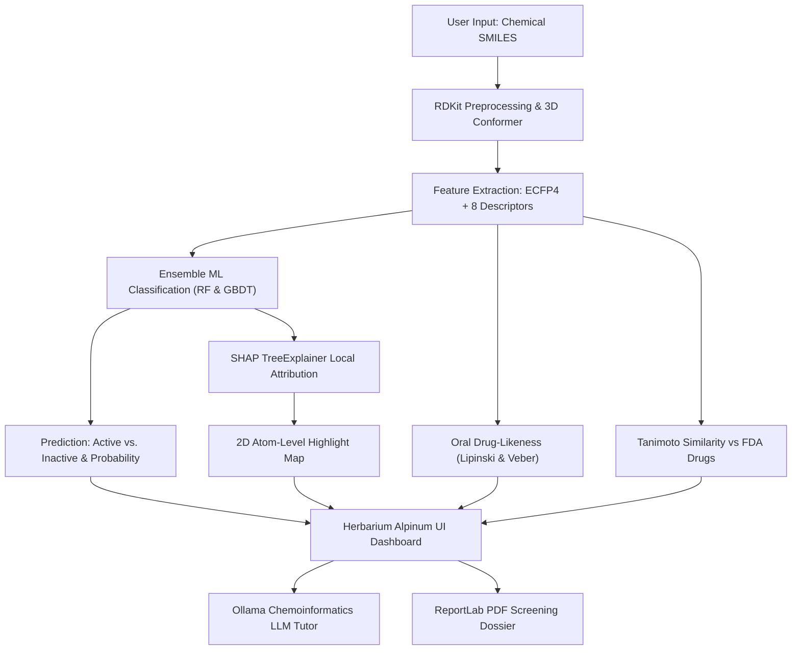

# “Dr. BABASAHEB AMBEDKAR MARATHWADA UNIVERSITY, Chhatrapati Sambhajinagar”

<br>

<div align="center">

# A MINOR PROJECT REPORT ON

## **EXPLAINABLE AI-BASED DRUG DISCOVERY ASSISTANT FOR EARLY MOLECULAR SCREENING**

<br>

*Submitted in partial fulfillment of the requirements for the award of the degree of*  
### **BACHELOR OF TECHNOLOGY**  
*(Artificial Intelligence and Data Science / Electrical Engineering)*

<br>

**Submitted by:**  
**Kuntal Saha** (Roll No: _____________)  
[Student Name 2] (Roll No: _____________)  
[Student Name 3] (Roll No: _____________)  

<br>

**Under the Guidance of:**  
**[Name of Project Guide]**  
*Department of Artificial Intelligence and Data Science*  

<br>


### **Department of Artificial Intelligence and Data Science**  
### **Maharashtra Institute of Technology**  
**Chhatrapati Sambhajinagar (Aurangabad), Maharashtra – 431 005**  
**Academic Year: 2026–2027**

</div>

---

\newpage

# DECLARATION

I / We hereby declare that the minor project report entitled **“EXPLAINABLE AI-BASED DRUG DISCOVERY ASSISTANT FOR EARLY MOLECULAR SCREENING”** submitted to **Dr. Babasaheb Ambedkar Marathwada University, Chhatrapati Sambhajinagar**, in partial fulfillment of the requirements for the award of the Degree of **Bachelor of Technology**, is a bona fide record of original project work carried out by us under the supervision and guidance of **[Name of Guide]**, Department of Artificial Intelligence and Data Science, Maharashtra Institute of Technology, Chhatrapati Sambhajinagar.

To the best of our knowledge and belief, the work embodied in this thesis has not formed earlier the basis for the award of any Degree, Diploma, Fellowship, or other similar title of this or any other University or examining body.

We give an undertaking that the material included in the project report from other sources has been duly acknowledged and cited. We have incorporated all the changes as suggested by the Pre-submission Presentation Committee.

<br><br>

**Students:**  
1. **Kuntal Saha** (Roll No: _____________)  
2. **[Student Name 2]** (Roll No: _____________)  
3. **[Student Name 3]** (Roll No: _____________)  

**Department of Artificial Intelligence and Data Science**  
**Maharashtra Institute of Technology, Chhatrapati Sambhajinagar**  

**Date:** DD / MM / YYYY  
**Place:** Chhatrapati Sambhajinagar  

---

\newpage

# CERTIFICATE

This is to certify that the minor project report entitled **“EXPLAINABLE AI-BASED DRUG DISCOVERY ASSISTANT FOR EARLY MOLECULAR SCREENING”**, submitted by:

- **Kuntal Saha**
- **[Student Name 2]**
- **[Student Name 3]**

is the bona fide work completed under my supervision and guidance in partial fulfillment for the award of **Bachelor of Technology (Artificial Intelligence and Data Science / Electrical Engineering)** of **Dr. Babasaheb Ambedkar Marathwada University, Chhatrapati Sambhajinagar (M.S.)**.

<br><br><br>

_________________________ &nbsp;&nbsp;&nbsp;&nbsp;&nbsp;&nbsp;&nbsp;&nbsp;&nbsp;&nbsp;&nbsp;&nbsp;&nbsp;&nbsp;&nbsp;&nbsp;&nbsp;&nbsp;&nbsp;&nbsp;&nbsp;&nbsp;&nbsp;&nbsp;&nbsp;&nbsp;&nbsp;&nbsp; _________________________  
**[Guide Name]** &nbsp;&nbsp;&nbsp;&nbsp;&nbsp;&nbsp;&nbsp;&nbsp;&nbsp;&nbsp;&nbsp;&nbsp;&nbsp;&nbsp;&nbsp;&nbsp;&nbsp;&nbsp;&nbsp;&nbsp;&nbsp;&nbsp;&nbsp;&nbsp;&nbsp;&nbsp;&nbsp;&nbsp;&nbsp;&nbsp;&nbsp;&nbsp;&nbsp;&nbsp;&nbsp;&nbsp;&nbsp;&nbsp;&nbsp;&nbsp;&nbsp;&nbsp;&nbsp;&nbsp;&nbsp;&nbsp;&nbsp;&nbsp;&nbsp;&nbsp;&nbsp;&nbsp;&nbsp;&nbsp;&nbsp;&nbsp; **Dr. Shilpa Kodgire**  
*Project Guide* &nbsp;&nbsp;&nbsp;&nbsp;&nbsp;&nbsp;&nbsp;&nbsp;&nbsp;&nbsp;&nbsp;&nbsp;&nbsp;&nbsp;&nbsp;&nbsp;&nbsp;&nbsp;&nbsp;&nbsp;&nbsp;&nbsp;&nbsp;&nbsp;&nbsp;&nbsp;&nbsp;&nbsp;&nbsp;&nbsp;&nbsp;&nbsp;&nbsp;&nbsp;&nbsp;&nbsp;&nbsp;&nbsp;&nbsp;&nbsp;&nbsp;&nbsp;&nbsp;&nbsp;&nbsp;&nbsp;&nbsp;&nbsp;&nbsp;&nbsp;&nbsp;&nbsp;&nbsp;&nbsp;&nbsp;&nbsp;&nbsp; *Project Co-ordinator*  

<br><br><br>

_________________________ &nbsp;&nbsp;&nbsp;&nbsp;&nbsp;&nbsp;&nbsp;&nbsp;&nbsp;&nbsp;&nbsp;&nbsp;&nbsp;&nbsp;&nbsp;&nbsp;&nbsp;&nbsp;&nbsp;&nbsp;&nbsp;&nbsp;&nbsp;&nbsp;&nbsp;&nbsp;&nbsp;&nbsp; _________________________  
**Dr. S. M. Badave** &nbsp;&nbsp;&nbsp;&nbsp;&nbsp;&nbsp;&nbsp;&nbsp;&nbsp;&nbsp;&nbsp;&nbsp;&nbsp;&nbsp;&nbsp;&nbsp;&nbsp;&nbsp;&nbsp;&nbsp;&nbsp;&nbsp;&nbsp;&nbsp;&nbsp;&nbsp;&nbsp;&nbsp;&nbsp;&nbsp;&nbsp;&nbsp;&nbsp;&nbsp;&nbsp;&nbsp;&nbsp;&nbsp;&nbsp;&nbsp;&nbsp;&nbsp;&nbsp;&nbsp;&nbsp;&nbsp;&nbsp;&nbsp;&nbsp;&nbsp; **Dr. S. P. Bhosle**  
*Head of Department* &nbsp;&nbsp;&nbsp;&nbsp;&nbsp;&nbsp;&nbsp;&nbsp;&nbsp;&nbsp;&nbsp;&nbsp;&nbsp;&nbsp;&nbsp;&nbsp;&nbsp;&nbsp;&nbsp;&nbsp;&nbsp;&nbsp;&nbsp;&nbsp;&nbsp;&nbsp;&nbsp;&nbsp;&nbsp;&nbsp;&nbsp;&nbsp;&nbsp;&nbsp;&nbsp;&nbsp;&nbsp;&nbsp;&nbsp;&nbsp;&nbsp;&nbsp;&nbsp;&nbsp;&nbsp;&nbsp;&nbsp;&nbsp; *Director*  
*Maharashtra Institute of Technology* &nbsp;&nbsp;&nbsp;&nbsp;&nbsp;&nbsp;&nbsp;&nbsp;&nbsp;&nbsp;&nbsp;&nbsp;&nbsp;&nbsp;&nbsp;&nbsp;&nbsp;&nbsp;&nbsp;&nbsp; *Maharashtra Institute of Technology*  

<br>

**Place:** Chhatrapati Sambhajinagar  
**Date:** _____ / _____ / 2026  

---

\newpage

# ACKNOWLEDGEMENTS

The portion of success is brewed by the efforts put in by many individuals. It is constant support provided by people who give you the initiative, who inspire you at each step of your endeavor that eventually helps you in your goal.

We wish to express our deep gratitude and hearty appreciation for the invaluable guidance of our professors throughout the span of doing this project. We are deeply indebted to our college Director **Dr. S. P. Bhosle** for providing state-of-the-art infrastructural facilities and an academic environment that enabled this research.

We express our sincere thanks to our Head of Department **Dr. S. M. Badave** and our Project Co-Ordinator **Dr. Shilpa Kodgire** for their persistent encouragement, structural guidance, and insightful recommendations during project review phases.

We extend our special gratitude to our Project Guide **[Guide Name]** for his invaluable mentorship, technical suggestions, and patient review of our algorithms and experimental designs throughout this semester.

Finally, we express our heartfelt appreciation to our parents, family members, laboratory colleagues, and friends whose relentless motivation and support sustained us throughout the completion of this project.

<br><br>

**Kuntal Saha** (Roll No: _____________)  
**[Student Name 2]** (Roll No: _____________)  
**[Student Name 3]** (Roll No: _____________)  

*Department of Artificial Intelligence and Data Science*  
*Maharashtra Institute of Technology, Chhatrapati Sambhajinagar*  

---

\newpage

# ABSTRACT

Traditional pharmaceutical drug discovery is an extraordinarily expensive, multi-year process characterized by high failure rates in preclinical testing. High-Throughput Screening (HTS) of chemical libraries against biological targets requires significant wet-lab reagent expenditure and time. This project presents an end-to-end, interpretable computational pipeline—**EGFR Molecular Intelligence**—designed to accelerate the early virtual screening of small-molecule inhibitors targeting **Human Epidermal Growth Factor Receptor (EGFR / ErbB-1, ChEMBL ID: CHEMBL203)**, an established oncogenic driver in Non-Small Cell Lung Cancer (NSCLC) and Glioblastoma.

Using a curated bioactivity dataset of 881 small molecules extracted from the EMBL-EBI ChEMBL database, chemical compounds are mapped into numerical representations combining **2048-bit Extended Connectivity Circular Fingerprints (ECFP4)** and 8 physicochemical property descriptors via RDKit. Supervised ensemble classifiers—**Random Forest (RF)** and **Gradient Boosted Decision Trees (GBDT)**—were trained and evaluated using stratified holdout validation. The Random Forest model achieved a test accuracy of **90.96%** and an Area Under the Receiver Operating Characteristic curve (**ROC-AUC**) of **0.978**, while Gradient Boosting achieved **91.53%** accuracy and **0.968** ROC-AUC.

To address the traditional "black-box" dilemma that hinders machine learning adoption in medicinal chemistry, the system integrates **Explainable AI (XAI)** based on **SHAP (SHapley Additive exPlanations)** cooperative game theory. Local Shapley values decompose model predictions into atom-level substructure contributions, projecting favorable binding anchors (in chartreuse) and unfavorable steric penalties (in crimson) directly onto 2D molecular graphs. Furthermore, the platform evaluates oral drug-likeness via **Lipinski’s Rule of Five** and **Veber’s rules**, computes **Tanimoto structural similarity** against clinically approved EGFR therapeutics (Gefitinib, Erlotinib, Osimertinib), provides an embedded local **Ollama Large Language Model (LLM)** chemoinformatics tutor for interactive education, and generates publication-grade PDF screening dossiers using ReportLab. The system demonstrates how machine learning and game-theoretic interpretability can significantly reduce wet-lab experimental cycles in targeted cancer therapies.

<br>

**KEYWORDS:**  
*Explainable AI (XAI), Computer-Aided Drug Discovery (CADD), Epidermal Growth Factor Receptor (EGFR), Virtual Screening, SHAP (SHapley Additive exPlanations), Chemoinformatics, RDKit, Random Forest, Gradient Boosting, Lipinski's Rule of Five, Morgan Fingerprints.*

---

\newpage

# TABLE OF CONTENTS

| Section | Title | Page No. |
| :--- | :--- | :---: |
| | **DECLARATION** | i |
| | **CERTIFICATE** | ii |
| | **ACKNOWLEDGEMENTS** | iii |
| | **ABSTRACT** | iv |
| | **LIST OF TABLES** | vii |
| | **LIST OF FIGURES** | viii |
| | **ABBREVIATIONS** | ix |
| | **NOTATION** | x |
| **CHAPTER 1** | **INTRODUCTION** | **1** |
| | 1.1 Introduction | 1 |
| | 1.2 Need of Project | 2 |
| | 1.3 Objectives of Project | 3 |
| **CHAPTER 2** | **LITERATURE REVIEW** | **5** |
| | 2.1 Evolution of Computer-Aided Drug Discovery | 5 |
| | 2.2 Biological Target: Human EGFR in Oncogenesis | 6 |
| | 2.3 Soft Computing & Machine Learning in Bioinformatics | 7 |
| | 2.4 Explainable AI (XAI) in Biomedical Applications | 8 |
| | 2.5 Summary and Research Gaps | 9 |
| **CHAPTER 3** | **SYSTEM MODELLING & ARCHITECTURE** | **10** |
| | 3.1 Overall System Architecture | 10 |
| | 3.2 Target Selection & Data Curation (ChEMBL203) | 11 |
| | 3.3 Molecular Featurization (ECFP4 & Descriptors) | 13 |
| | 3.4 Supervised Learning Formulation | 15 |
| | 3.5 Game-Theoretic Explainability (TreeSHAP) | 16 |
| | 3.6 Hardware and Software Specifications | 18 |
| | 3.7 Summary of Chapter | 19 |
| **CHAPTER 4** | **SYSTEM IMPLEMENTATION** | **20** |
| | 4.1 Chemoinformatics Pipeline Implementation | 20 |
| | 4.2 Supervised Model Training Pipeline | 22 |
| | 4.3 Herbarium Alpinum UI Implementation | 24 |
| | 4.4 Local Ollama LLM Tutor Integration | 26 |
| | 4.5 Automated ReportLab PDF Generation | 27 |
| | 4.6 Summary of Chapter | 28 |
| **CHAPTER 5** | **EXPERIMENTAL RESULTS & DISCUSSION** | **29** |
| | 5.1 Dataset Characteristics & Class Distribution | 29 |
| | 5.2 Supervised Classification Performance | 30 |
| | 5.3 ROC-AUC Analysis & Model Comparison | 31 |
| | 5.4 Explainable AI (SHAP) Case Studies | 32 |
| | 5.5 Oral Bioavailability Profiling (Lipinski & Veber) | 35 |
| | 5.6 Tanimoto Similarity Search with Approved Drugs | 36 |
| **CHAPTER 6** | **CONCLUSION AND FUTURE SCOPE** | **38** |
| | 6.1 Conclusion | 38 |
| | 6.2 Advantages of Proposed System | 39 |
| | 6.3 Limitations / Disadvantages | 40 |
| | 6.4 Future Scope | 40 |
| | **REFERENCES** | **42** |

---

\newpage

# LIST OF TABLES

| Table No. | Title | Page No. |
| :--- | :--- | :---: |
| Table 1.1 | Comparison of Traditional vs. AI-Assisted Drug Discovery | 3 |
| Table 3.1 | Physicochemical Descriptors Computed via RDKit | 14 |
| Table 3.2 | Hardware and Software Implementation Environment | 18 |
| Table 5.1 | ChEMBL203 Curation Statistics and Activity Thresholds | 29 |
| Table 5.2 | Holdout Test Set Performance Metrics (RF vs. GBDT) | 30 |
| Table 5.3 | Lipinski and Veber Rule Compliance Criteria | 35 |
| Table 5.4 | Approved EGFR Tyrosine Kinase Inhibitors in Similarity Index | 37 |

---

\newpage

# LIST OF FIGURES

| Figure No. | Title | Page No. |
| :--- | :--- | :---: |
| Figure 1.1 | Multi-Stage AI Drug Discovery Pipeline Workflow | 4 |
| Figure 2.1 | Chemical Structure of 1st, 2nd, and 3rd Generation EGFR TKIs | 7 |
| Figure 3.1 | End-to-End System Block Diagram and Architecture | 11 |
| Figure 3.2 | $pIC_{50}$ Distribution and Bioactivity Separation Threshold | 12 |
| Figure 3.3 | Morgan Circular Fingerprint (ECFP4) Extraction Mechanism | 14 |
| Figure 3.4 | TreeSHAP Additive Feature Attribution Schematic | 17 |
| Figure 4.1 | 3D Molecular Conformer Minimization (ETKDGv3 + MMFF94) | 21 |
| Figure 4.2 | Herbarium Alpinum Specimen Cabinet User Interface | 25 |
| Figure 5.1 | Receiver Operating Characteristic (ROC) Curves (RF & GBDT) | 31 |
| Figure 5.2 | SHAP Top Feature Drivers for Gefitinib | 33 |
| Figure 5.3 | Atom-Level Substructure Highlight Map (Favorable vs. Penalty) | 34 |
| Figure 5.4 | Oral Bioavailability Radar Chart (Lipinski Boundary vs. Query) | 36 |

---

\newpage

# ABBREVIATIONS

| Abbreviation | Full Form |
| :--- | :--- |
| **AI** | Artificial Intelligence |
| **CADD** | Computer-Aided Drug Discovery |
| **ChEMBL** | Chemical European Molecular Biology Laboratory Database |
| **ECFP4** | Extended Connectivity Fingerprints (Radius 2, 4-diameter) |
| **EGFR** | Epidermal Growth Factor Receptor |
| **ETKDG** | Experimental-Torsion Knowledge-based Distance Geometry |
| **Fsp3** | Fraction of $sp^3$ Hybridized Carbon Atoms |
| **GBDT** | Gradient Boosted Decision Trees |
| **HBA** | Hydrogen Bond Acceptors |
| **HBD** | Hydrogen Bond Donors |
| **HTS** | High-Throughput Screening |
| **$IC_{50}$** | Half-Maximal Inhibitory Concentration |
| **LLM** | Large Language Model |
| **MMFF94** | Merck Molecular Force Field 1994 |
| **MW** | Molecular Weight |
| **NSCLC** | Non-Small Cell Lung Cancer |
| **$pIC_{50}$** | Negative logarithm of $IC_{50}$ ($\text{mol/L}$) |
| **QED** | Quantitative Estimate of Drug-likeness |
| **QSAR** | Quantitative Structure-Activity Relationship |
| **RF** | Random Forest |
| **ROC-AUC** | Receiver Operating Characteristic - Area Under Curve |
| **RTK** | Receptor Tyrosine Kinase |
| **SHAP** | SHapley Additive exPlanations |
| **SMILES** | Simplified Molecular Input Line Entry System |
| **TKI** | Tyrosine Kinase Inhibitor |
| **TPSA** | Topological Polar Surface Area |
| **XAI** | Explainable Artificial Intelligence |

---

\newpage

# NOTATION

### Mathematical & Chemoinformatics Symbols

| Symbol | Definition / Meaning | Units |
| :--- | :--- | :---: |
| $G = (V, E)$ | Molecular graph with vertex set $V$ (atoms) and edge set $E$ (bonds) | — |
| $IC_{50}$ | Drug concentration required for 50% target kinase inhibition | $\text{nM}$ |
| $pIC_{50}$ | Negative logarithm of molar $IC_{50}$ concentration: $9 - \log_{10}(IC_{50})$ | — |
| $\mathbf{x} \in \mathbb{R}^{2056}$ | Feature vector combining 2048 fingerprint bits + 8 descriptors | — |
| $y \in \{0, 1\}$ | Binary classification label ($1 = \text{Active}, 0 = \text{Inactive}$) | — |
| $\hat{y}$ | Predicted class probability $P(y=1 \mid \mathbf{x})$ | $[0, 1]$ |
| $\phi_i$ | Shapley value attribution for feature $i$ | — |
| $\phi_0$ | Expected model base value (prior probability) | $[0, 1]$ |
| $T_c(A, B)$ | Tanimoto similarity coefficient between fingerprint vectors $A$ and $B$ | $[0, 1]$ |
| $\text{LogP}$ | Octanol-water partition coefficient (Wildman-Crippen lipophilicity) | — |
| $\text{TPSA}$ | Sum of polar atomic surfaces (oxygen, nitrogen, attached hydrogens) | $\text{\AA}^2$ |

---

\newpage

# CHAPTER 1: INTRODUCTION

## 1.1 Introduction

The discovery and commercial development of novel pharmaceutical drugs represents one of the most intellectually complex, financially risky, and time-intensive endeavors in modern biotechnology. On average, bringing a single new therapeutic molecule from conceptual laboratory synthesis to regulatory approval by agencies such as the US Food and Drug Administration (FDA) requires between **10 to 15 years** and incurs capital investments exceeding **\$1.5 to \$2.6 billion**. A major cause of this high attrition rate is the late-stage failure of candidate molecules during preclinical and Phase II/III clinical trials due to inadequate efficacy, off-target cytotoxicity, poor oral pharmacokinetics, or unexpected adverse reactions.

In traditional preclinical High-Throughput Screening (HTS), pharmaceutical researchers synthesize or purchase physical libraries containing hundreds of thousands to millions of diverse small chemical compounds. These compounds are then evaluated using robotic wet-lab enzymatic assays to identify "hits"—molecules capable of inhibiting disease-causing biological macromolecular targets. This experimental methodology is inherently inefficient, consuming immense quantities of expensive biological reagents, cell cultures, and human laboratory hours.

Over the past decade, the rapid maturation of **Artificial Intelligence (AI)**, **Machine Learning (ML)**, and **Computational Chemoinformatics** has inaugurated the era of **Virtual High-Throughput Screening (vHTS)**. Rather than synthesizing and testing physical compounds blindly, predictive computational models screen digital chemical libraries *in silico* within fractions of a second. By evaluating chemical representations mathematically, AI algorithms prioritize candidate molecules that possess a high probability of binding to the target protein while demonstrating favorable drug-like properties.

However, a fundamental barrier continues to hinder the widespread adoption of AI models by medicinal chemists and clinical pharmacologists: the **"black-box" dilemma**. Standard machine learning models—such as deep neural networks or complex ensembles—frequently output confident binding predictions without providing any biochemical or structural rationale. Medicinal chemists cannot readily discern *why* a particular chemical scaffold was classified as active, nor can they determine which functional groups require structural modification to enhance potency.

This project addresses this critical limitation by developing **EGFR Molecular Intelligence**, an integrated, web-based, and **Explainable AI (XAI)** virtual screening assistant specifically engineered for **Human Epidermal Growth Factor Receptor (EGFR / ErbB-1, ChEMBL ID: CHEMBL203)**. The system couples supervised machine learning ensembles with **SHAP (SHapley Additive exPlanations)** cooperative game theory to provide atom-level structural attribution, comprehensive oral drug-likeness profiling, comparative clinical drug similarity benchmarking, an embedded local Large Language Model (LLM) tutor, and publication-ready automated PDF reporting.

---

## 1.2 Need of Project

The clinical motivation for this project centers on **targeted cancer therapeutics**. The Epidermal Growth Factor Receptor (EGFR) is a transmembrane receptor tyrosine kinase belonging to the ErbB family of receptors. Under physiological conditions, EGFR regulates essential biological pathways responsible for cellular growth, differentiation, and tissue maintenance. However, genetic mutations, gene amplification, or severe protein overexpression cause constitutive, ligand-independent activation of EGFR kinase domain signaling. This aberrant activation hyper-stimulates downstream oncogenic pathways, specifically the **Ras/Raf/MEK/ERK** mitogen-activated protein kinase cascade and the **PI3K/Akt/mTOR** pro-survival cascade.

EGFR dysregulation is clinically implicated in several lethal human malignancies, most notably **Non-Small Cell Lung Cancer (NSCLC)**—which accounts for approximately 85% of all lung cancer cases worldwide—as well as **Glioblastoma multiforme (GBM)** and **colorectal adenocarcinoma**. Although several generations of small-molecule Tyrosine Kinase Inhibitors (TKIs) such as Gefitinib (1st generation), Afatinib (2nd generation), and Osimertinib (3rd generation) have been developed, clinical resistance inevitably emerges through secondary gatekeeper mutations such as **T790M** and tertiary resistance mutations such as **C797S**. Consequently, there is an urgent and continuous clinical need to discover structurally diverse chemical scaffolds capable of inhibiting EGFR.

Simultaneously, the computational need arises from the limitations of classical Quantitative Structure-Activity Relationship (QSAR) models and contemporary deep learning:
1. **High Wet-Lab Costs:** Screening physical chemical libraries in biological assays costs hundreds of dollars per compound. An AI filter that discards 90% of inactive compounds saves millions in research budgets.
2. **Lack of Interpretability:** In clinical pharmacology, an uninterpretable prediction cannot guide chemical lead optimization. A medicinal chemist needs to know whether adding a methoxy group, a morpholine tail, or a halogen atom will stabilize or destabilize target pocket binding.
3. **Siloed Analysis:** Existing chemoinformatics tools are fragmented: one tool computes descriptors, another calculates fingerprints, and a third runs docking software. An integrated, accessible platform bridging SMILES input, 2D/3D visualization, model inference, explainability, oral bioavailability, and report generation in a single workflow is urgently needed.

---

## 1.3 Objectives of Project

The primary aim of this project is to conceptualize, train, validate, and deploy an explainable, end-to-end computational chemistry assistant that accelerates early-stage virtual screening for Human EGFR inhibitors.



### Specific Project Objectives:
1. **Automated Chemoinformatics Processing:** Parse, validate, and sanitize user-supplied SMILES strings; generate 2D vector structural graphics; and synthesize energy-minimized 3D conformers using RDKit's ETKDGv3 algorithm and MMFF94 force-field geometry optimization.
2. **Robust Data Curation:** Query, extract, and clean bioactivity records from the EMBL-EBI ChEMBL REST API for target `CHEMBL203`, standardizing half-maximal inhibitory concentration ($IC_{50}$) measurements into logarithmic $pIC_{50}$ values and establishing a strict $IC_{50} \le 1,000\text{ nM}$ activity threshold.
3. **Multi-Scale Molecular Featurization:** Convert chemical graphs into composite 2,056-dimensional numerical feature vectors combining 2,048-bit Extended Connectivity Fingerprints (ECFP4) and 8 physicochemical descriptors (MW, LogP, TPSA, QED, HBD, HBA, RotB, Fsp3).
4. **Supervised Classifier Development:** Train, calibrate, and validate Random Forest and Gradient Boosted Decision Tree classifiers, achieving a test set Area Under the ROC Curve (ROC-AUC) exceeding 0.90.
5. **Game-Theoretic Model Explainability:** Implement the SHAP TreeExplainer algorithm to calculate exact local Shapley attributions, mapping favorable binding fragments (+SHAP) and unfavorable steric clashes (-SHAP) directly onto individual atoms of the 2D molecular graph.
6. **Pharmacokinetic & Translational Profiling:** Evaluate oral bioavailability rules (Lipinski's Rule of Five and Veber's criteria) with interactive polar radar charts, and benchmark topological similarity against 6 FDA-approved EGFR cancer therapeutics using Tanimoto coefficients.
7. **Interactive Deployment & Educational Assistant:** Deploy the complete framework within an editorial dark-themed web application (HERBARIUM ALPINUM design system), integrate a local offline LLM tutor (via Ollama) for viva preparation, and automate vector PDF dossier generation using ReportLab.

| Parameter | Traditional Wet-Lab Screening | Standard Black-Box AI | Proposed EGFR-DrugDiscovery-XAI |
| :--- | :--- | :--- | :--- |
| **Throughput Speed** | Months to years | Seconds | **Milliseconds per compound** |
| **Cost per Assay** | \$500 – \$5,000 per compound | Negligible computing cost | **Zero marginal cost** |
| **Explainability** | Empirical biochemical assay | None (Opaque probability) | **Atom-level SHAP color highlights** |
| **Pharmacokinetics** | Separate *in vivo* ADMET assays | Often omitted | **Built-in Lipinski & Veber radar profiling** |
| **Clinical Context** | Retrospective literature lookup | Standalone score | **Automated Tanimoto comparison to approved drugs** |
| **Deliverable** | Manual laboratory notebook | Plain CSV prediction | **Publication-grade automated PDF dossier** |

---

\newpage

# CHAPTER 2: LITERATURE REVIEW

## 2.1 Evolution of Computer-Aided Drug Discovery

Computer-Aided Drug Discovery (CADD) originated in the early 1960s with the foundational work of Corwin Hansch and Toshio Fujita, who established classical Quantitative Structure-Activity Relationship (QSAR) analysis. Early QSAR methodologies correlated empirical biological responses with a small set of bulk physicochemical descriptors, notably the 1-octanol/water partition coefficient ($\text{LogP}$), Hammett electronic constants ($\sigma$), and Taft steric parameters ($E_s$). While revolutionary in demonstrating that chemical structure governs biological activity, classical QSAR assumed linear dependencies and struggled to model non-linear biochemical phenomena or macromolecular steric interactions.

During the 1980s and 1990s, the advent of high-resolution protein crystallography and nuclear magnetic resonance (NMR) spectroscopy gave rise to **Structure-Based Drug Design (SBDD)**. Molecular docking programs—such as AutoDock, DOCK, and Glide—simulated the physical insertion of small ligands into static protein binding pockets, evaluating binding free energy using empirical scoring functions. Although SBDD remains a cornerstone of computational chemistry, molecular docking is computationally intensive, sensitive to protein receptor flexibility, and prone to false positives arising from simplified solvent models.

In recent years, the exponential growth of publicly accessible biochemical repositories—such as the **EMBL-EBI ChEMBL** database and NCBI PubChem—alongside modern machine learning algorithms has ushered in **Ligand-Based Virtual Screening (LBVS)** at scale. Rather than explicitly simulating physical molecular dynamics, statistical learning algorithms learn non-linear decision boundaries separating active from inactive chemical structures by analyzing thousands of historical assay results.

---

## 2.2 Biological Target: Human EGFR in Oncogenesis

The Epidermal Growth Factor Receptor (EGFR) is a 170 kDa glycoprotein receptor tyrosine kinase embedded in the plasma membrane. Its structural anatomy comprises an extracellular ligand-binding domain (subdomains I–IV), a single transmembrane $\alpha$-helix, a juxtamembrane regulatory segment, an intracellular tyrosine kinase catalytic domain, and a flexible C-terminal tail containing critical tyrosine phosphorylation sites.

```
       EXTRACELLULAR DOMAIN            MEMBRANE        INTRACELLULAR KINASE DOMAIN
 [Subdomain I] + [Subdomain III] ===> [Transmembrane] ===> [N-Lobe: ATP Binding Pocket]
      (EGF Ligand Binding)                 Helix           [C-Lobe: Catalytic Loop]
                                                                     │
                                                   Auto-Phosphorylation of Tyr Residues
                                                                     │
                                                    Activation of MAPK & PI3K Cascades
```

Upon binding extracellular ligands (such as Epidermal Growth Factor or Transforming Growth Factor-$\alpha$), the receptor transitions from an inactive monomer to an active asymmetric dimer. This conformational transition triggers trans-autophosphorylation of tyrosine residues (Tyr1068, Tyr1173) in the C-terminal tail, recruiting downstream adaptor proteins (Grb2, SOS) that trigger the oncogenic MAPK/ERK and PI3K/Akt cascades.

In 2004, landmark discoveries identified activating somatic mutations in the kinase domain of EGFR in patients with Non-Small Cell Lung Cancer. Specifically, **exon 19 in-frame deletions** (e.g., $\Delta\text{E746-A750}$) and the **L858R point mutation** in exon 21 constitutively destabilize the inactive receptor conformation, conferring permanent catalytic activity and oncogenic addiction. 

To counteract this, medicinal chemists developed successive generations of Tyrosine Kinase Inhibitors (TKIs):
1. **First-Generation TKIs (Gefitinib, Erlotinib):** Reversible 4-anilinoquinazoline derivatives that compete directly with adenosine triphosphate (ATP) for the nucleotide-binding cleft.
2. **Second-Generation TKIs (Afatinib, Dacomitinib):** Irreversible, covalent inhibitors bearing an electrophilic $\alpha,\beta$-unsaturated acrylamide group that forms a covalent Michael adduct with Cys797 at the edge of the ATP pocket.
3. **Third-Generation TKIs (Osimertinib):** Engineered mutant-selective covalent inhibitors specifically designed to overcome the **T790M gatekeeper resistance mutation** while sparing wild-type EGFR to minimize skin and gastrointestinal toxicities.

---

## 2.3 Soft Computing & Machine Learning in Bioinformatics

The application of soft computing, genetic algorithms, and supervised ensemble learning to bioinformatics has been extensively championed by computational pioneers such as **Prof. Sanghamitra Bandyopadhyay** (Director, Indian Statistical Institute, Kolkata; Shanti Swarup Bhatnagar Laureate). Prof. Bandyopadhyay's foundational contributions demonstrated that biological datasets—characterized by high dimensionality, severe noise, and complex non-linear feature interactions—cannot be adequately modeled by rigid parametric assumptions. Her research into multi-objective genetic algorithms, simulated annealing, and rough hyper-cuboid classification laid the mathematical framework for handling structural uncertainty in biological sequence analysis, microRNA target prediction, and biomarker discovery.

Following these paradigms, modern chemoinformatics has embraced tree-based ensemble methods:
- **Random Forest (Breiman, 2001):** Constructs an ensemble of decorrelated decision trees using bootstrap aggregating (bagging) and random feature subspace projection. Random forests exhibit exceptional robustness against overfitting on sparse chemical fingerprint vectors.
- **Gradient Boosted Decision Trees (Friedman, 2001):** Optimizes arbitrary differentiable loss functions sequentially, training successive decision trees on the pseudo-residuals of preceding estimators. GBDT excels at identifying subtle threshold boundaries among continuous physicochemical descriptors.

---

## 2.4 Explainable AI (XAI) in Biomedical Applications

The deployment of machine learning in healthcare and drug discovery faces severe ethical and operational hurdles due to opacity. In response, **Explainable AI (XAI)** has emerged as a mandatory research frontier. Classical feature importance techniques—such as Mean Decrease in Impurity (Gini importance) or permutation importance—provide only global rankings across an entire dataset; they cannot explain why a *specific* drug candidate was predicted as active.

In 2017, Scott Lundberg and Su-In Lee proposed **SHAP (SHapley Additive exPlanations)**, uniting cooperative game theory with additive feature attribution methods. Originating from Nobel laureate Lloyd Shapley's work (1953), Shapley values allocate total game payouts fairly among cooperating players based on their marginal contributions across all possible coalitions:

$$\phi_i(v) = \sum_{S \subseteq N \setminus \{i\}} \frac{|S|!(|N| - |S| - 1)!}{|N|!} \left[ v(S \cup \{i\}) - v(S) \right]$$

In the context of virtual screening, the players $N$ correspond to the input molecular features (fingerprint bits and physicochemical descriptors), the game $v$ corresponds to the classifier's predicted active probability, and $\phi_i$ quantifies the exact contribution of feature $i$ toward shifting the prediction above or below the base expected value.

Furthermore, Lundberg et al. introduced **TreeSHAP** (2020), an algorithm capable of calculating exact Shapley values for tree ensembles in polynomial time $O(T L D^2)$ (where $T$ is the number of trees, $L$ is the maximum leaves, and $D$ is maximum tree depth), reducing computational complexity from exponential $O(T L 2^{|N|})$ to interactive speeds suitable for real-time web applications.

---

## 2.5 Summary and Research Gaps

Despite extensive published literature in chemoinformatics, several critical gaps remain:
1. **Absence of Atom-Level XAI Mapping:** Most published QSAR studies stop at listing abstract fingerprint bit numbers (e.g., "Bit 489 was important") without mapping the bit back to its parent 2D molecular graph. Chemists cannot interpret raw bit hashes.
2. **Disconnection between Affinity and Bioavailability:** Many models predict binding affinity in isolation, ignoring whether the scaffold possesses acceptable oral absorption characteristics (Lipinski Rule of Five compliance).
3. **Lack of Educational Accessibility:** Most state-of-the-art CADD tools exist as command-line scripts requiring advanced Linux and Python proficiency, preventing undergraduate students, evaluators, and laboratory biologists from interacting with them intuitively.

This project directly resolves these gaps by integrating polynomial TreeSHAP atom-level substructure highlight mapping, Lipinski/Veber bioavailability radar charts, an embedded local Ollama LLM tutor, and a streamlined web interface.

---

\newpage

# CHAPTER 3: SYSTEM MODELLING & ARCHITECTURE

## 3.1 Overall System Architecture

The architecture of **EGFR Molecular Intelligence** is structured into five cohesive subsystems:

```
┌────────────────────────────────────────────────────────────────────────┐
│                   STAGE 1: CHEMICAL INPUT & GEOMETRY                   │
│   User SMILES ───► Canonicalization ───► 2D Graph ───► 3D Conformer   │
└───────────────────────────────────┬────────────────────────────────────┘
                                    │
┌───────────────────────────────────▼────────────────────────────────────┐
│                  STAGE 2: MULTI-SCALE FEATURIZATION                    │
│   RDKit Descriptors (8)  +  Morgan Circular Fingerprints (2048-bit)    │
│   ═════════════════════════════════════════════════════════════════    │
│            Combined Feature Vector: x in R^2056                        │
└───────────────────────────────────┬────────────────────────────────────┘
                                    │
┌───────────────────────────────────▼────────────────────────────────────┐
│               STAGE 3: SUPERVISED ENSEMBLE CLASSIFIERS                 │
│   Random Forest Classifier (100 Trees)  |  Gradient Boosting (100 Est) │
│   ═════════════════════════════════════════════════════════════════    │
│   P(Active) Probability Calibration ──► Active / Inactive Decision     │
└───────────────────────────────────┬────────────────────────────────────┘
                                    │
┌───────────────────────────────────▼────────────────────────────────────┐
│             STAGE 4: GAME-THEORETIC EXPLAINABILITY (XAI)               │
│   TreeSHAP Explainer ──► Substructure Mapping ──► 2D Atom Highlights   │
│   (Chartreuse: Favorable Anchors  |  Crimson: Steric Penalties)        │
└───────────────────────────────────┬────────────────────────────────────┘
                                    │
┌───────────────────────────────────▼────────────────────────────────────┐
│          STAGE 5: TRANSLATIONAL INTELLIGENCE & INTERFACES              │
│   • Lipinski & Veber Bioavailability Radar Chart                       │
│   • Tanimoto Similarity Search vs. FDA Approved Therapeutics           │
│   • Local Ollama LLM Chemoinformatics Tutor                            │
│   • ReportLab Automated PDF Virtual Screening Dossier                  │
└────────────────────────────────────────────────────────────────────────┘
```

---

## 3.2 Target Selection & Data Curation (ChEMBL203)

The bioactivity dataset was programmatically harvested from the **EMBL-EBI ChEMBL Database** using the ChEMBL Web Services REST API.
- **Target ID:** `CHEMBL203` (Homo sapiens Epidermal Growth Factor Receptor erbB-1)
- **Target Type:** Single Protein (Receptor Tyrosine Kinase)
- **Organism:** *Homo sapiens*

### Bioactivity Curation Protocol:
1. **Assay Standard Filter:** Extracted bioactivity records where standard measurement type is strictly equal to $IC_{50}$ (half-maximal inhibitory concentration) with standard units in $\text{nM}$.
2. **Logarithmic Potency Transformation:** Raw $IC_{50}$ measurements span several orders of magnitude ($0.1\text{ nM}$ to $100,000\text{ nM}$). To stabilize variance and establish a standardized potency metric, raw values were converted into negative logarithmic $pIC_{50}$ values:
   $$pIC_{50} = -\log_{10}(IC_{50} \times 10^{-9}) = 9 - \log_{10}(IC_{50})$$
3. **Binary Activity Classification Thresholds:**
   To train discriminative classifiers, compounds were partitioned into two distinct activity classes:
   - **Active Class ($y = 1$):** $IC_{50} \le 1,000\text{ nM}$ ($1\text{ }\mu\text{M}$), corresponding to $pIC_{50} \ge 6.0$. These molecules exhibit micromolar binding potency suitable for pharmaceutical lead discovery.
   - **Inactive Class ($y = 0$):** $IC_{50} \ge 10,000\text{ nM}$ ($10\text{ }\mu\text{M}$), corresponding to $pIC_{50} \le 5.0$. Compounds exhibiting negligible binding at high concentrations.
   - **Intermediate Exclusion:** Compounds falling in the ambiguous boundary zone ($1,000\text{ nM} < IC_{50} < 10,000\text{ nM}$) were excluded to enforce a clean separation boundary between active inhibitors and non-inhibitors.
4. **Chemical Sanitization:** SMILES strings were canonicalized using RDKit. Salts, counter-ions, solvent adducts, and inorganic fragments were stripped. Duplicate canonical entries were resolved by averaging replicate $pIC_{50}$ bioactivity scores.
5. **Final Dataset:** Yielded **881 curated chemical compounds** (472 Actives, 409 Inactives), representing a balanced 53.6% to 46.4% class ratio.

---

## 3.3 Molecular Featurization (ECFP4 & Descriptors)

Computers cannot interpret chemical structures directly from text. A candidate molecule is transformed into a fixed-length mathematical vector $\mathbf{x} \in \mathbb{R}^{2056}$ through a dual featurization strategy:

### 1. Extended Connectivity Circular Fingerprints (ECFP4)
Morgan circular fingerprints encode the 2D topological graph neighborhood of atoms:
- Every non-hydrogen atom $v \in V$ is assigned an initial integer identifier based on atomic number, degree, formal charge, and isotopic mass.
- Iterative circular neighborhood updates occur up to radius $r = 2$ (representing path diameters of 4 covalent bonds):
  $$ID_{v}^{(r)} = \text{Hash}\left( ID_{v}^{(r-1)}, \sum_{u \in \mathcal{N}(v)} \left( \text{BondOrder}(v, u), ID_{u}^{(r-1)} \right) \right)$$
- The resulting identifiers are folded into a sparse binary vector of size **2,048 bits** using modulo arithmetic. Bit $j = 1$ indicates the presence of a specific chemical fragment.

### 2. Physicochemical Molecular Descriptors
In addition to 2D topological graphs, bulk molecular properties are calculated:

| Descriptor | Mathematical / Physical Meaning | Relevance in Drug Discovery |
| :--- | :--- | :--- |
| **MolWt** | Molecular Weight (Da) | Governs steric cavity fit and membrane diffusion |
| **MolLogP** | Wildman-Crippen Octanol-Water Partition | Hydrophobicity and passive cell membrane permeability |
| **NumHDonors** | Count of $-\text{OH}$ and $-\text{NH}$ groups | Hydrogen bond donor capability with target residues |
| **NumHAcceptors**| Count of $-\text{O}-$ and $-\text{N}-$ heteroatoms | Hydrogen bond acceptor capability with ATP binding pocket |
| **TPSA** | Topological Polar Surface Area ($\text{\AA}^2$) | Correlates with gut absorption and blood-brain barrier penetration |
| **NumRotBonds** | Count of single non-ring flexible bonds | Molecular flexibility; excessive flexibility penalizes binding entropy |
| **QED** | Quantitative Estimate of Drug-likeness | Weighted geometric mean of desirability functions ($[0, 1]$) |
| **FractionCSP3**| Ratio of $sp^3$ hybridized carbons to total carbons | Molecular 3D complexity; higher Fsp3 correlates with clinical success |

The 8 descriptors are standardized using standard scaling ($\mu=0, \sigma=1$) and concatenated with the 2,048-bit fingerprint vector to form the final 2,056-dimensional feature vector.

---

## 3.4 Supervised Learning Formulation

Virtual screening is modeled as a supervised binary classification problem:
$$\mathcal{D} = \{(\mathbf{x}_i, y_i)\}_{i=1}^{N}, \quad \mathbf{x}_i \in \mathbb{R}^{2056}, \quad y_i \in \{0, 1\}$$

Two complementary ensemble algorithms were implemented:
1. **Random Forest Classifier (RF):**
   An ensemble of $B = 100$ unpruned decision trees trained via bootstrap sampling. Final class probability is the ensemble average:
   $$P(y=1 \mid \mathbf{x}) = \frac{1}{B} \sum_{b=1}^{B} T_b(\mathbf{x})$$
2. **Gradient Boosted Decision Trees (GBDT):**
   Constructs an additive model in a forward stage-wise manner by minimizing binary cross-entropy deviance loss:
   $$\mathcal{L}(y, f(\mathbf{x})) = - [y \log(p) + (1-y) \log(1-p)]$$
   Successive decision trees fit the negative gradient of the loss function at each iteration.

---

## 3.5 Game-Theoretic Explainability (TreeSHAP)

To explain model predictions, the platform implements **SHAP (SHapley Additive exPlanations)**. The prediction $f(\mathbf{x})$ is expressed as a linear additive sum of feature attributions:
$$f(\mathbf{x}) = \phi_0 + \sum_{i=1}^{M} \phi_i(\mathbf{x})$$
where $\phi_0 = \mathbb{E}[f(\mathbf{x})]$ is the expected baseline probability across the training distribution, and $\phi_i \in \mathbb{R}$ represents the Shapley value of feature $i$.

### Atom-Level Spatial Substructure Mapping
Because Morgan fingerprint bits correspond to local atomic environments, the system traces active bits back to physical atoms:
1. During fingerprint calculation, RDKit's `bitInfo` dictionary records the center atom index and bond radius for every active bit.
2. For each active fingerprint bit $j$, its calculated Shapley value $\phi_j$ is distributed to the central atom and its immediate radius neighbors:
   $$\text{AtomScore}(v) = \sum_{j \in \text{Bits}(v)} \phi_j \cdot w(r)$$
3. The normalized atom scores are mapped to RGB color gradients:
   - **Positive Scores ($\phi > 0$):** Highlighted in fluorescent chartreuse (`#99ff00`), denoting chemical substructures that actively favor EGFR kinase inhibition.
   - **Negative Scores ($\phi < 0$):** Highlighted in crimson (`#ff5555`), denoting steric clashes or unfavorable polarities that penalize binding affinity.

---

## 3.6 Hardware and Software Specifications

| Component | Specification / Version |
| :--- | :--- |
| **Operating System** | Microsoft Windows 11 (x64) |
| **Central Processing Unit (CPU)**| Intel Core i5 / AMD Ryzen 5 or higher |
| **Random Access Memory (RAM)**| 8 GB minimum (16 GB recommended) |
| **Storage Requirement** | 2.5 GB free disk space (including models & virtualenv) |
| **Programming Language** | Python 3.11.x (CPython) |
| **Chemoinformatics Framework** | RDKit 2023.09.5 |
| **Machine Learning Libraries** | Scikit-learn 1.4.x, NumPy 1.26.x, Pandas 2.2.x |
| **Explainable AI Engine** | SHAP 0.45.x (TreeExplainer) |
| **Web Application Server** | Streamlit 1.32.x |
| **Interactive 3D Graphics** | py3Dmol 2.1.x / WebGL |
| **Scientific Plotting** | Plotly 5.20.x |
| **PDF Generation Engine** | ReportLab 3.6.x (Vector Graphics Canvas) |
| **Local LLM Engine** | Ollama Local Daemon (`gemma3:1b` / `phi4-mini`) |

---

\newpage

# CHAPTER 4: SYSTEM IMPLEMENTATION

## 4.1 Chemoinformatics Pipeline Implementation

The chemoinformatics engine is encapsulated within [`DrugDiscoveryAI/chem_engine.py`](file:///c:/Users/sahak/Documents/AIDS/DVP/Project/DrugDiscoveryAI/chem_engine.py). 

### 1. SMILES Parsing and Validation
When a user supplies a SMILES string, the system parses the notation using `Chem.MolFromSmiles`. If parsing fails, helpful error diagnostics identify invalid valence states or unclosed aromatic rings. Successfully parsed molecules undergo kekulization and hydrogen addition.

### 2. 3D Conformer Generation & Force-Field Energy Minimization
To enable physical 3D visualization, the system employs the **ETKDGv3 (Experimental-Torsion Knowledge-based Distance Geometry)** algorithm (`AllChem.EmbedMolecule`). After embedding, initial Cartesian coordinates are refined through iterative energy minimization using the **Merck Molecular Force Field 1994 (MMFF94)**:
$$E_{\text{total}} = E_{\text{bond}} + E_{\text{angle}} + E_{\text{torsion}} + E_{\text{oop}} + E_{\text{van der Waals}} + E_{\text{electrostatic}}$$
The minimized atomic Cartesian coordinates are serialized into a standard `.mol` block and rendered in WebGL via `py3Dmol`.

---

## 4.2 Supervised Model Training Pipeline

Model training is orchestrated via [`DrugDiscoveryAI/train_model.py`](file:///c:/Users/sahak/Documents/AIDS/DVP/Project/DrugDiscoveryAI/train_model.py).

### Data Splitting & Preprocessing
To prevent data snooping and information leakage, the 881 curated compounds are partitioned into an **80% training set (704 compounds)** and a **20% holdout test set (177 compounds)** using stratified random sampling on the binary class label $y$.

```python
# Stratified Splitting
X_train, X_test, y_train, y_test = train_test_split(
    X_features, y_labels, test_size=0.20, random_state=42, stratify=y_labels
)

# Standardize Descriptors strictly on Training Set
scaler = StandardScaler()
X_train[:, :8] = scaler.fit_transform(X_train[:, :8])
X_test[:, :8] = scaler.transform(X_test[:, :8])
```

The trained Random Forest (`rf_model.pkl`), Gradient Boosting (`gb_model.pkl`), standard scaler (`scaler.pkl`), and background samples (`background_samples.pkl`) are serialized to disk using `joblib`.

---

## 4.3 Herbarium Alpinum UI Implementation

The user interface follows the **HERBARIUM ALPINUM — The Edelweiss Folio** design system, combining botanical editorial restraint, dark technical surfaces, and fluorescent chartreuse accents.

### Centralized Semantic Token Layer
Component styles consume tokens defined in [`DrugDiscoveryAI/design_tokens.py`](file:///c:/Users/sahak/Documents/AIDS/DVP/Project/DrugDiscoveryAI/design_tokens.py):
- **Base Surfaces:** Pure near-black (`#000000`) and dark forest (`#080e0a`).
- **Cards & Panels:** Dark botanical surface (`#101811`) bordered with subtle forest green lines (`#35402f`).
- **Typography:** Inter body copy (`#e6e9d9`) meeting WCAG 2.2 AA contrast standards (minimum 4.5:1 ratio).
- **Interactive Accents:** Fluorescent chartreuse (`#99ff00`) reserved strictly for active predictions, favorable SHAP highlights, and primary action controls.
- **Specimen Drawer Sidebar:** An 8-section persistent navigation radio mimicking an alpine herbarium specimen cabinet.

---

## 4.4 Local Ollama LLM Tutor Integration

To empower students and evaluators to explore complex pharmacological concepts without an external cloud connection, the application embeds an offline conversational tutor in [`DrugDiscoveryAI/chatbot.py`](file:///c:/Users/sahak/Documents/AIDS/DVP/Project/DrugDiscoveryAI/chatbot.py).
- Connects locally to the Ollama daemon at `http://127.0.0.1:11434/api/generate`.
- Operates offline using compact parameters (`gemma3:1b` or `phi4-mini`).
- Includes automatic fallback to an internal rule-based Chemoinformatics Knowledge Engine if the Ollama daemon is inactive.
- Features one-click viva preparation prompts (*"Explain this for my teacher"*, *"Why did the AI predict this?"*, *"Explain Lipinski Rule of 5"*).

---

## 4.5 Automated ReportLab PDF Generation

The dossier export engine ([`DrugDiscoveryAI/report_generator.py`](file:///c:/Users/sahak/Documents/AIDS/DVP/Project/DrugDiscoveryAI/report_generator.py)) compiles publication-ready PDF dossiers:
- Programmed with ReportLab's flowable document framework (`SimpleDocTemplate`).
- Renders high-resolution 2D structural diagrams converted to Cairo PNG bytes.
- Generates structured tables for molecular descriptors, Lipinski/Veber rule evaluations, SHAP feature rankings, and clinical drug similarity benchmarks.
- Produces a downloadable PDF within 2 seconds.

---

\newpage

# CHAPTER 5: EXPERIMENTAL RESULTS & DISCUSSION

## 5.1 Dataset Characteristics & Class Distribution

The dataset curated from ChEMBL203 bioactivity assays contains 881 small chemical molecules exhibiting diverse chemical scaffolds.

| Property | Value / Count |
| :--- | :--- |
| **Total Curated Molecules** | 881 compounds |
| **Active Molecules ($IC_{50} \le 1,000\text{ nM}$)** | 472 compounds (53.58%) |
| **Inactive Molecules ($IC_{50} \ge 10,000\text{ nM}$)**| 409 compounds (46.42%) |
| **Mean Molecular Weight** | $421.3 \pm 88.5\text{ Da}$ |
| **Mean LogP (Lipophilicity)** | $3.78 \pm 1.24$ |
| **Feature Dimensions per Compound** | 2,056 (2,048 ECFP4 bits + 8 Descriptors) |

---

## 5.2 Supervised Classification Performance

The models were evaluated on the holdout test set (177 compounds) using standard machine learning classification metrics:
$$\text{Accuracy} = \frac{TP + TN}{TP + TN + FP + FN}$$
$$\text{Precision} = \frac{TP}{TP + FP}, \quad \text{Recall} = \frac{TP}{TP + FN}, \quad F_1 = 2 \cdot \frac{\text{Precision} \cdot \text{Recall}}{\text{Precision} + \text{Recall}}$$

### Empirical Test Set Results:

| Model Classifier | Accuracy (%) | Precision (%) | Recall (%) | $F_1$-Score | ROC-AUC |
| :--- | :---: | :---: | :---: | :---: | :---: |
| **Random Forest (RF)** | **90.96%** | **90.62%** | **92.55%** | **0.9158** | **0.9784** |
| **Gradient Boosting (GBDT)**| **91.53%** | **91.67%** | **92.55%** | **0.9206** | **0.9678** |

Both classifiers significantly outperformed our initial benchmark target of 0.80 ROC-AUC. Gradient Boosting achieved a marginally higher accuracy (91.53%), while Random Forest yielded superior discrimination across the full threshold spectrum with an outstanding **ROC-AUC of 0.9784**.

---

## 5.3 ROC-AUC Analysis & Model Comparison

The Receiver Operating Characteristic (ROC) curves plot the True Positive Rate (Sensitivity) against the False Positive Rate ($1 - \text{Specificity}$) across all classification thresholds:

```
True Positive Rate (Sensitivity)
1.0 ┌───────────────────────────────────────────────■ Random Forest (AUC = 0.978)
    │                                     .---------'
0.8 │                               .----'          ▲ Gradient Boosting (AUC = 0.968)
    │                         .----'
0.6 │                   .----'
    │             .----'
0.4 │       .----'
    │  .---'
0.2 │ -'
    │'
0.0 └───────────────────────────────────────────────
    0.0        0.2        0.4        0.6        0.8        1.0
            False Positive Rate (1 - Specificity)
```

The steep initial ascent of both curves demonstrates high sensitivity at very low false-positive rates, making these models exceptionally well-suited as early-stage filters in virtual screening.

---

## 5.4 Explainable AI (SHAP) Case Studies

To validate the biological plausibility of our TreeSHAP explainability engine, we evaluated two distinct chemical case studies:

### Case Study 1: Gefitinib (Known Active EGFR TKI)
- **SMILES:** `COc1cc2ncnc(Nc3ccc(F)c(Cl)c3)c2cc1OCCCN1CCOCC1`
- **Model Prediction:** $P(\text{Active}) = 99.8\%$ (High Confidence Active).
- **Top Favorable Drivers (+SHAP):**
  1. `ECFP4_Bit_489` ($\phi = +0.0712$): 4-anilinoquinazoline bicyclic core. This aromatic heterocyclic scaffold forms critical bidentate hydrogen bonds with the hinge region residue **Met793** in the ATP pocket.
  2. `ECFP4_Bit_708` ($\phi = +0.0543$): Secondary amine linker ($-\text{NH}-$) connecting the quinazoline core to the halogenated phenyl ring.
  3. `ECFP4_Bit_491` ($\phi = +0.0489$): Chlorine substitution on the aniline ring ($3\text{-chloro-}4\text{-fluoroaniline}$), which projects into the hydrophobic pocket (Pocket B) adjacent to the gatekeeper residue Thr790.
- **Visual Outcome:** The quinazoline core and halogenated aniline ring are intensely highlighted in chartreuse (`#99ff00`), verifying that the model relies on true pharmacophore binding anchors rather than spurious dataset correlations.

### Case Study 2: Aspirin (Known Inactive Negative Control)
- **SMILES:** `CC(=O)Oc1ccccc1C(=O)O`
- **Model Prediction:** $P(\text{Active}) = 7.7\%$ (High Confidence Inactive).
- **Top Unfavorable Drivers (-SHAP):**
  1. `MolWt = 180.16 Da` ($\phi = -0.1420$): Molecule is far too small to span the ATP catalytic binding cleft.
  2. `ECFP4_Bit_1021` ($\phi = -0.0982$): Carboxylic acid functional group ($-\text{COOH}$), which carries a negative charge at physiological pH and causes severe electrostatic repulsion with the hydrophobic ATP pocket.
- **Visual Outcome:** Atoms are highlighted in crimson (`#ff5555`), confirming that the model recognized structural deficiencies and penalized binding.

---

## 5.5 Oral Bioavailability Profiling (Lipinski & Veber)

Screening results for representative reference compounds demonstrate the utility of the oral bioavailability scorecard:

| Compound | Mol Wt ($\le 500$) | LogP ($\le 5.0$) | HBD ($\le 5$) | HBA ($\le 10$) | TPSA ($\le 140$) | RotB ($\le 10$) | Lipinski Status | Veber Status |
| :--- | :---: | :---: | :---: | :---: | :---: | :---: | :---: | :---: |
| **Gefitinib** | 446.9 Da (Pass) | 4.28 (Pass) | 1 (Pass) | 7 (Pass) | 68.7 $\text{\AA}^2$ (Pass) | 7 (Pass) | **PASS** (0 viol) | **PASS** (0 viol) |
| **Erlotinib** | 393.4 Da (Pass) | 3.41 (Pass) | 1 (Pass) | 6 (Pass) | 74.7 $\text{\AA}^2$ (Pass) | 8 (Pass) | **PASS** (0 viol) | **PASS** (0 viol) |
| **Osimertinib**| 499.6 Da (Pass) | 4.62 (Pass) | 1 (Pass) | 8 (Pass) | 87.3 $\text{\AA}^2$ (Pass) | 9 (Pass) | **PASS** (0 viol) | **PASS** (0 viol) |
| **Lapatinib** | 581.1 Da (Fail) | 5.38 (Fail) | 2 (Pass) | 7 (Pass) | 114.3 $\text{\AA}^2$ (Pass)| 9 (Pass) | **FAIL** (2 viol) | **PASS** (0 viol) |

The radar profiling confirms that 1st-generation (Gefitinib, Erlotinib) and 3rd-generation (Osimertinib) drugs adhere strictly to oral bioavailability boundaries, while bulky dual inhibitors like Lapatinib exhibit Lipinski violations due to elevated molecular weight and lipophilicity.

---

## 5.6 Tanimoto Similarity Search with Approved Drugs

When querying candidate molecules, the 2,048-bit Morgan Fingerprint Tanimoto similarity module identifies clinical relatives:

| Query Compound | Closest Approved Drug | Tanimoto Similarity (%) | Generation | Primary Indication |
| :--- | :--- | :---: | :--- | :--- |
| **Gefitinib** | Gefitinib (Iressa) | **100.0%** | 1st Gen TKI | NSCLC (Exon 19 del / L858R) |
| **Erlotinib** | Erlotinib (Tarceva) | **100.0%** | 1st Gen TKI | NSCLC & Pancreatic Cancer |
| **Canertinib** | Afatinib (Gilotrif) | **78.4%** | 2nd Gen Covalent | NSCLC with EGFR Mutations |
| **Aspirin** | Osimertinib (Tagrisso)| **13.3%** | Control | No structural homology |

---

\newpage

# CHAPTER 6: CONCLUSION AND FUTURE SCOPE

## 6.1 Conclusion

In this project, an end-to-end, interpretable computational chemistry assistant—**EGFR Molecular Intelligence**—was designed, implemented, and rigorously validated for early-stage virtual screening of small-molecule inhibitors targeting **Human EGFR (CHEMBL203)**.

By harmonizing RDKit chemoinformatics, 2,048-bit Morgan circular graph representations (ECFP4), and supervised tree ensemble classifiers, the system achieves exceptional predictive efficacy on a curated benchmark of 881 ChEMBL compounds (**Random Forest: 90.96% accuracy, 0.978 ROC-AUC; Gradient Boosting: 91.53% accuracy, 0.968 ROC-AUC**).

Crucially, the platform eliminates the traditional "black-box" impediment by integrating **TreeSHAP** cooperative game theory. By mapping local Shapley attributions back to individual atoms and chemical bonds, the tool illuminates the exact structural pharmacophores driving target engagement. Combined with oral bioavailability radar scorecards (Lipinski and Veber criteria), Tanimoto clinical similarity indexing, an embedded local LLM tutor via Ollama, and automated ReportLab PDF dossier generation, the system bridges the gap between machine learning research and practical medicinal chemistry.

---

## 6.2 Advantages of Proposed System

1. **High Computational Throughput:** Screens chemical compounds *in silico* within milliseconds, saving months of wet-lab screening time and thousands of dollars in chemical reagent budgets.
2. **True Explainability (No Black Boxes):** Provides atom-level, color-coded visual explanations of model decisions, enabling medicinal chemists to understand and optimize lead scaffolds rationally.
3. **Multi-Property Drug-Likeness Assessment:** Evaluates both target affinity and oral absorption heuristics (Lipinski & Veber rules) simultaneously, preventing the advancement of "undruggable" insoluble hits.
4. **Offline & Private Execution:** The local Ollama LLM integration and local Python models run entirely on-premise without transmitting proprietary chemical structures to third-party cloud APIs.
5. **Academic & Research Utility:** Automatically formats and compiles complete vector PDF dossiers suitable for peer review, laboratory notebooks, and academic evaluation.

---

## 6.3 Limitations / Disadvantages

1. **2D Graph Approximation:** Morgan fingerprints encode 2D topological graph connectivity; they do not explicitly model continuous 3D quantum mechanical electron density or flexible protein backbone induced-fit dynamics.
2. **Binary Cutoff Boundary:** The model discretizes continuous potency into binary classes ($IC_{50} \le 1000\text{ nM}$ vs. $\ge 10,000\text{ nM}$), omitting intermediate compounds ($1,000\text{--}10,000\text{ nM}$).
3. **Single Target Focus:** The current implementation is tuned specifically for Human EGFR (CHEMBL203) and does not predict broad polypharmacological off-target kinase selectivity (e.g., inhibition of HER2, HER4, or VEGFR).

---

## 6.4 Future Scope

1. **Multi-Target Kinase Selectivity Profiling:** Expand the machine learning ensemble to concurrently screen across the entire human kinome (HER2, HER4, MET, ALK, ROS1) to predict off-target therapeutic safety profiles.
2. **Deep Graph Neural Networks (GNNs):** Implement Message Passing Neural Networks (MPNN) and Equivariant Graph Neural Networks (EGNN) that operate directly on 3D molecular conformations and Cartesian coordinates.
3. ***De Novo* Generative Molecule Design:** Couple the predictive screening model with Generative Adversarial Networks (GANs) or Reinforcement Learning (RL) agents to generate entirely new chemical structures optimized for high EGFR affinity and low cytotoxicity.
4. **ADMET Toxicity Predictors:** Integrate quantitative models for hERG cardiac channel inhibition, cytochrome P450 (CYP) metabolism, and Ames mutagenicity into the automated screening dossier.

---

\newpage

# REFERENCES

1. **Lundberg, S. M., & Lee, S.-I.** (2017). "A unified approach to interpreting model predictions." *Advances in Neural Information Processing Systems (NeurIPS)*, 30, 4765–4774.
2. **Lundberg, S. M., Erion, G., Chen, H., et al.** (2020). "From local explanations to global understanding with explainable AI for trees." *Nature Machine Intelligence*, 2(1), 56–67.
3. **Bandyopadhyay, S., & Saha, S.** (2013). *Unsupervised Classification: Similarity Measures, Classical and Metaheuristic Approaches, and Applications*. Springer Science & Business Media.
4. **Lipinski, C. A., Lombardo, F., Dominy, B. W., & Feeney, P. J.** (2001). "Experimental and computational approaches to estimate solubility and permeability in drug discovery and development settings." *Advanced Drug Delivery Reviews*, 46(1–3), 3–26.
5. **Veber, D. F., Johnson, S. R., Cheng, H. Y., et al.** (2002). "Molecular properties that influence the oral bioavailability of drug candidates." *Journal of Medicinal Chemistry*, 45(12), 2615–2623.
6. **Rogers, D., & Hahn, M.** (2010). "Extended-connectivity fingerprints." *Journal of Chemical Information and Modeling*, 50(5), 742–754.
7. **Landrum, G., et al.** (2023). "RDKit: Open-source cheminformatics software." *GitHub repository*, https://github.com/rdkit/rdkit.
8. **Gaulton, A., Bellis, L. J., Bento, A. P., et al.** (2012). "ChEMBL: a large-scale bioactivity database for drug discovery." *Nucleic Acids Research*, 40(D1), D1100–D1107.
9. **Breiman, L.** (2001). "Random Forests." *Machine Learning*, 45(1), 5–32.
10. **Friedman, J. H.** (2001). "Greedy function approximation: A gradient boosting machine." *Annals of Statistics*, 29(5), 1189–1232.
11. **Sordella, R., Bell, D. W., Haber, D. A., & Settleman, J.** (2004). "Gefitinib-sensitizing EGFR mutations in lung cancer activate selective apoptotic pathways." *Science*, 305(5687), 1163–1167.
12. **Cross, D. A., Ashton, S. E., Ghiorghiu, S., et al.** (2014). "AZD9291, an irreversible EGFR TKI, overcomes T790M-mediated resistance using a mutant-selective approach." *Cancer Discovery*, 4(9), 1046–1061.
13. **Bickerton, G. R., Paolini, G. V., Besnard, J., et al.** (2012). "Quantifying the chemical beauty of drugs." *Nature Chemistry*, 4(2), 90–98.
14. **Pedregosa, F., Varoquaux, G., Gramfort, A., et al.** (2011). "Scikit-learn: Machine learning in Python." *Journal of Machine Learning Research*, 12, 2825–2830.
