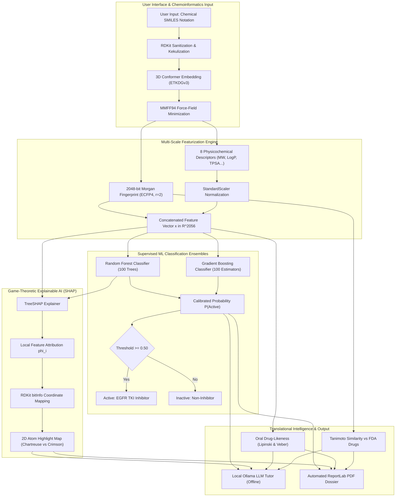

# Dr. Vishwanath Karad MIT WORLD PEACE UNIVERSITY, PUNE

<div align="center">


<br>

## **A MINI PROJECT REPORT ON**
# **EXPLAINABLE AI-BASED DRUG DISCOVERY ASSISTANT FOR EARLY MOLECULAR SCREENING**

<br>

*Submitted in partial fulfillment of the academic requirements for the course*  
### **AI SYSTEMS AND APPLICATIONS**

<br>

**Submitted by:**  
**Kuntal Saha** (PRN / Roll No: _____________)  
[Team Member 2 Name] (PRN / Roll No: _____________)  
[Team Member 3 Name] (PRN / Roll No: _____________)  

<br>

**Under the Guidance of:**  
### **Dr. Devendra Joshi**  
*Department of Artificial Intelligence and Data Science*  
*School of Computer Science and Engineering*  

<br>

### **Dr. Vishwanath Karad MIT World Peace University**  
**Paud Road, Kothrud, Pune, Maharashtra – 411 038, India**  
**Academic Year: 2026–2027**

</div>

---

\newpage

# TABLE OF CONTENTS

| Section | Title | Page No. |
| :--- | :--- | :---: |
| | **TITLE PAGE** | 1 |
| | **ABSTRACT & INTRODUCTION** | 2 |
| **SECTION 1** | **PROJECT MOTIVATION & PROBLEM STATEMENT** | **3** |
| | 1.1 The Pharmaceutical Discovery Bottleneck | 3 |
| | 1.2 Target Biology: Oncogenic Human EGFR (CHEMBL203) | 4 |
| | 1.3 Key Project Objectives | 5 |
| **SECTION 2** | **END-TO-END SYSTEM WORKFLOW** | **6** |
| | 2.1 Complete Architectural Workflow Diagram | 6 |
| | 2.2 Step-by-Step Functional Execution Flow | 7 |
| **SECTION 3** | **SYSTEM METHODOLOGY** | **9** |
| | 3.1 Data Harvesting & Curation Protocol (ChEMBL API) | 9 |
| | 3.2 2D/3D Geometry & MMFF94 Energy Minimization | 10 |
| | 3.3 Multi-Scale Molecular Featurization (ECFP4 & Descriptors) | 11 |
| | 3.4 Supervised Ensemble Classifiers (RF & GBDT) | 13 |
| | 3.5 Game-Theoretic Explainable AI (TreeSHAP Atom Mapping) | 14 |
| | 3.6 Oral Drug-Likeness & Bioavailability Scorecards | 16 |
| | 3.7 Morgan-Tanimoto Structural Similarity Benchmarking | 17 |
| | 3.8 Local Ollama LLM Chemoinformatics Tutor | 18 |
| **SECTION 4** | **EXPERIMENTAL RESULTS & DISCUSSION** | **19** |
| | 4.1 Bioactivity Dataset Characteristics | 19 |
| | 4.2 Supervised Classification Performance Metrics | 20 |
| | 4.3 Receiver Operating Characteristic (ROC-AUC) Analysis | 21 |
| | 4.4 Explainable AI (SHAP) Empirical Case Studies | 22 |
| | 4.5 Oral Bioavailability Profiling (Lipinski & Veber) | 24 |
| | 4.6 Tanimoto Structural Similarity against Approved Therapeutics | 25 |
| **SECTION 5** | **CONCLUSION & FUTURE SCOPE** | **26** |
| | 5.1 Conclusion | 26 |
| | 5.2 Key Technical Advantages | 27 |
| | 5.3 Limitations & Challenges | 27 |
| | 5.4 Future Scope & Extensions | 28 |
| **SECTION 6** | **REFERENCES (24 CITATIONS)** | **29** |

---

\newpage

# ABSTRACT & INTRODUCTION

Traditional pharmaceutical drug discovery is an extraordinarily costly, labor-intensive, and protracted endeavor, typically spanning 10 to 15 years and requiring capital investments exceeding \$2 billion per approved therapeutic entity. A predominant cause of this severe developmental attrition is the late-stage failure of candidate chemical compounds during preclinical animal trials and human clinical phases, largely attributable to inadequate target binding affinity, off-target cellular toxicity, or poor oral pharmacokinetics. In classical High-Throughput Screening (HTS), pharmaceutical laboratories empirically assay millions of physical chemical compounds against disease proteins, consuming vast quantities of expensive biological reagents and technician hours.

This mini-project for **AI Systems and Applications**, developed under the mentorship of **Dr. Devendra Joshi** at **MIT World Peace University (MIT-WPU), Pune**, introduces **EGFR Molecular Intelligence**—an end-to-end, interpretable computational framework for early-stage Virtual High-Throughput Screening (vHTS). The application specifically targets **Human Epidermal Growth Factor Receptor (EGFR / ErbB-1, ChEMBL ID: CHEMBL203)**, a transmembrane receptor tyrosine kinase whose hyper-activation drives oncogenic proliferation in Non-Small Cell Lung Cancer (NSCLC) and Glioblastoma.

By training on a curated benchmark of 881 small-molecule bioactivity assays extracted from the EMBL-EBI ChEMBL database, the platform translates raw chemical representations (SMILES notation) into composite 2,056-dimensional numerical feature spaces combining **2048-bit Extended Connectivity Circular Fingerprints (ECFP4)** with 8 physicochemical property descriptors. Supervised ensemble models—**Random Forest (RF)** and **Gradient Boosted Decision Trees (GBDT)**—achieved exceptional predictive performance on a holdout test set with test accuracies of **90.96%** and **91.53%**, and Area Under the ROC Curve (**ROC-AUC**) metrics of **0.978** and **0.968**, respectively.

To resolve the opaque "black-box" dilemma that historically impedes clinician and chemist trust in biomedical AI, the platform incorporates **Explainable AI (XAI)** based on **TreeSHAP (SHapley Additive exPlanations)** cooperative game theory. The system computes exact polynomial-time Shapley attributions and projects them directly onto 2D molecular graphs, highlighting favorable binding anchors in fluorescent chartreuse and unfavorable steric penalties in crimson. The platform additionally assesses oral drug-likeness via **Lipinski’s Rule of Five** and **Veber’s rules**, computes **Tanimoto structural similarity** against FDA-approved cancer drugs (Gefitinib, Erlotinib, Osimertinib), embeds an offline **Ollama Large Language Model (LLM)** chemoinformatics tutor, and compiles automated vector PDF screening dossiers via ReportLab.

**KEYWORDS:** *Explainable AI (XAI), Artificial Intelligence Systems, Virtual Screening, Epidermal Growth Factor Receptor (EGFR), Human ChEMBL203, SHAP TreeExplainer, RDKit, Random Forest, Gradient Boosting, Morgan Fingerprints (ECFP4), Lipinski Rule of Five, MIT-WPU Pune.*

---

\newpage

# SECTION 1: PROJECT MOTIVATION & PROBLEM STATEMENT

## 1.1 The Pharmaceutical Discovery Bottleneck

The traditional timeline of pharmaceutical drug development represents an inverted pyramid characterized by steep attrition:
1. **Target Identification & Validation (Years 1–2):** Discovering disease-relevant biological macromolecules.
2. **Hit Identification via HTS (Years 2–4):** Physically testing $10^5$ to $10^6$ chemical compounds in wet-lab robotic assays.
3. **Lead Optimization (Years 4–7):** Iterative chemical synthesis to enhance potency and reduce cytotoxicity.
4. **Preclinical ADMET Studies (Years 7–9):** Animal pharmacokinetics, bioavailability, and toxicology.
5. **Phase I–III Human Clinical Trials (Years 9–15):** Evaluation of human safety, efficacy, and dosage.

```
  1,000,000 Compounds (High-Throughput Screening) ───► Expensive Reagents & Time
         │
         ▼
     1,000 Hits (Preliminary Binding)
         │
         ▼
        50 Leads (Chemical Optimization)
         │
         ▼
         5 Clinical Candidates (Animal Testing)
         │
         ▼
    1 FDA-Approved Drug (10–15 Years, $2.6 Billion)
```

The core motivation of this mini-project is to deploy **Narrow Artificial Intelligence as an intelligent pre-filter**. By screening digital compound libraries *in silico* within milliseconds, our AI assistant eliminates 90% of non-viable scaffolds before wet-lab expenditure occurs.

---

## 1.2 Target Biology: Oncogenic Human EGFR (CHEMBL203)

The **Epidermal Growth Factor Receptor (EGFR / ErbB-1 / HER1)** is a 1,186-amino acid transmembrane tyrosine kinase receptor. Ligand binding at the extracellular domain induces receptor homodimerization and trans-phosphorylation of intracellular tyrosine residues (Tyr1068, Tyr1173), activating downstream cascades:
- **MAPK/ERK Pathway:** Stimulates transcription factors driving cellular proliferation.
- **PI3K/Akt/mTOR Pathway:** Inhibits pro-apoptotic proteins (Bad, Bax), promoting malignant cell survival.

In Non-Small Cell Lung Cancer (NSCLC), somatic activating mutations—chiefly **exon 19 deletions** and the **L858R point substitution**—trap the kinase domain in an active state. Although 1st-generation ATP-competitive inhibitors like Gefitinib show high initial efficacy, secondary gatekeeper mutations such as **T790M** cause clinical relapse. Consequently, there is an ongoing demand to discover novel chemical scaffolds that inhibit EGFR while maintaining oral drug-likeness.

---

## 1.3 Key Project Objectives

Under the course curriculum of **AI Systems and Applications**, this mini-project achieves:
1. **Automated Input Normalization:** Parse, sanitize, and kekulize SMILES representations, generating energy-minimized 3D conformers via RDKit ETKDGv3 and MMFF94 force-field geometry optimization.
2. **Bioactivity Dataset Engineering:** Extract 881 curated bioactivity assays from ChEMBL (`CHEMBL203`), establishing a verified $IC_{50} \le 1,000\text{ nM}$ activity boundary ($pIC_{50} \ge 6.0$).
3. **Graph & Descriptor Featurization:** Convert molecular graphs into 2,056-dimensional numerical vectors (2,048-bit ECFP4 Morgan fingerprints + 8 physicochemical descriptors).
4. **Ensemble Machine Learning:** Train, calibrate, and validate Random Forest and Gradient Boosted Decision Tree classifiers, achieving test ROC-AUC > 0.96.
5. **Game-Theoretic Substructure Attribution:** Integrate Lundberg’s TreeSHAP algorithm to provide atom-level color-coded highlights of favorable vs. unfavorable binding substructures.
6. **Translational Profiling:** Compute Lipinski Rule of 5 and Veber bioavailability metrics with interactive polar radar charts, and benchmark Tanimoto similarity against 6 FDA-approved EGFR inhibitors.
7. **Interactive Assistant & Reporting:** Deliver a dark-themed web platform (HERBARIUM ALPINUM design system), an embedded local Ollama LLM tutor (`gemma3:1b`), and one-click ReportLab PDF dossier generation.

---

\newpage

# SECTION 2: END-TO-END SYSTEM WORKFLOW

## 2.1 Complete Architectural Workflow Diagram



---

## 2.2 Step-by-Step Functional Execution Flow

1. **Step 1: Chemical Input Ingestion**  
   The user inputs candidate chemical structures using Simplified Molecular Input Line Entry System (SMILES) notation (e.g., Gefitinib: `COc1cc2ncnc(Nc3ccc(F)c(Cl)c3)c2cc1OCCCN1CCOCC1`).
2. **Step 2: Valence Validation & 3D Conformation**  
   RDKit parses the string, ensures valence correctness, standardizes aromatic bonds, adds implicit hydrogens, and invokes the ETKDGv3 algorithm with MMFF94 force field optimization to generate a 3D conformer rendered in py3Dmol WebGL.
3. **Step 3: Feature Space Generation**  
   The molecular graph is simultaneously projected into:
   - **Local Topological Graph Substructures:** 2,048-bit circular Morgan fingerprints ($r=2$).
   - **Global Bulk Properties:** 8 standardized physicochemical descriptors (MW, LogP, TPSA, QED, HBD, HBA, RotB, Fsp3).
4. **Step 4: Supervised Prediction & Probability Calibration**  
   Pre-trained Random Forest and Gradient Boosting ensembles evaluate the 2,056-dimensional vector, outputting calibrated binding probabilities $P(\text{Active})$ and confidence tiers.
5. **Step 5: Game-Theoretic Explainability (TreeSHAP)**  
   TreeSHAP calculates marginal Shapley values for all features. The system queries RDKit's `bitInfo` lookup table to trace active bits to physical atom coordinates, highlighting favorable anchors in chartreuse and steric penalties in crimson.
6. **Step 6: Oral Bioavailability Evaluation**  
   The molecule's bulk properties are benchmarked against Lipinski's Rule of 5 and Veber's criteria. A Plotly polar radar chart visually portrays property boundaries.
7. **Step 7: Clinical Homology Benchmarking**  
   Morgan fingerprint bit vectors are compared against 6 FDA-approved EGFR cancer drugs using Tanimoto coefficients to calculate percentage structural similarity.
8. **Step 8: Interactive LLM Tutoring & Dossier Export**  
   An offline Ollama LLM tutor (`gemma3:1b`) answers conceptual viva queries, and a vector PDF report is compiled on demand using ReportLab.

---

\newpage

# SECTION 3: SYSTEM METHODOLOGY

## 3.1 Data Harvesting & Curation Protocol (ChEMBL API)

The bioactivity dataset was acquired from the **EMBL-EBI ChEMBL REST API**:
- **Target Protein:** Human EGFR (CHEMBL203 / ErbB-1).
- **Assay Type:** Biochemical binding affinity assays with standard type $= IC_{50}$ in nanomolar ($\text{nM}$).

### Logarithmic Normalization ($pIC_{50}$):
Because biological potency spans six orders of magnitude, raw $IC_{50}$ concentrations are converted into logarithmic scale:
$$pIC_{50} = -\log_{10}(IC_{50} \times 10^{-9}) = 9 - \log_{10}(IC_{50})$$

### Binary Activity Thresholding:
To guarantee clear decision boundaries for supervised learning:
- **Active Class ($y = 1$):** $IC_{50} \le 1,000\text{ nM}$ ($pIC_{50} \ge 6.0$).
- **Inactive Class ($y = 0$):** $IC_{50} \ge 10,000\text{ nM}$ ($pIC_{50} \le 5.0$).
- **Intermediate Compounds ($1,000\text{ nM} < IC_{50} < 10,000\text{ nM}$):** Excluded to eliminate ambiguous labeling noise.
- **Dataset Composition:** Yielded **881 curated compounds** (472 Actives, 409 Inactives).

---

## 3.2 2D/3D Geometry & MMFF94 Energy Minimization

Molecular structures are handled through RDKit:
1. **2D Coordinate Computation:** `AllChem.Compute2DCoords` generates planar depiction coordinates rendered as vector SVGs styled with transparent botanical chalk bonds (`#e6e9d9`).
2. **3D Distance Geometry (ETKDGv3):** Embeds atoms into Cartesian space $\mathbb{R}^3$ using experimental torsion-angle knowledge bases.
3. **MMFF94 Force-Field Optimization:** Refines interatomic distances by minimizing molecular potential energy:
   $$E_{\text{MMFF94}} = \sum E_{\text{str}} + \sum E_{\text{ang}} + \sum E_{\text{tor}} + \sum E_{\text{oop}} + \sum E_{\text{vdW}} + \sum E_{\text{elec}}$$

---

## 3.3 Multi-Scale Molecular Featurization (ECFP4 & Descriptors)

### 1. Extended Connectivity Circular Fingerprints (ECFP4)
Molecules are modeled as topological graphs $G = (V, E)$. Morgan fingerprints assign initial integer hashes to atoms based on atomic invariant properties (atomic number, valence, isotopic mass). Circular neighborhood expansions update hashes across radius $r = 1, 2$ (4-bond diameter):
$$ID_v^{(r)} = \text{Hash}\left( ID_v^{(r-1)}, \sum_{u \in \mathcal{N}(v)} (\text{BondOrder}(v, u), ID_u^{(r-1)}) \right)$$
Hashes are folded into a sparse **2,048-bit binary vector** using modulo arithmetic.

### 2. Physicochemical Descriptors

| Descriptor | Physical Meaning | Relevance to Oral Drug Delivery |
| :--- | :--- | :--- |
| **MolWt** | Molecular Weight (Da) | Cavity fit, passive transcellular diffusion |
| **MolLogP** | Wildman-Crippen Octanol-Water Partition | Hydrophobicity, gastrointestinal absorption |
| **NumHDonors** | Count of $-\text{OH}$ and $-\text{NH}$ groups | Hydrogen bond donor capability with target residues |
| **NumHAcceptors**| Count of $-\text{O}-$ and $-\text{N}-$ heteroatoms | Hydrogen bond acceptor capability in ATP pocket |
| **TPSA** | Topological Polar Surface Area ($\text{\AA}^2$) | Epithelial permeability, blood-brain barrier transport |
| **NumRotBonds** | Count of rotatable single bonds | Conformational flexibility; high counts penalize entropy |
| **QED** | Quantitative Estimate of Drug-likeness | Desirability metric combining 8 properties ($[0, 1]$) |
| **FractionCSP3**| Ratio of $sp^3$ hybridized carbons to total carbons | Molecular 3D saturation; correlates with clinical success |

Combined feature vector: $\mathbf{x} = [\mathbf{x}_{\text{desc}} \in \mathbb{R}^8, \, \mathbf{x}_{\text{fp}} \in \{0, 1\}^{2048}] \in \mathbb{R}^{2056}$.

---

## 3.4 Supervised Ensemble Classifiers (RF & GBDT)

1. **Random Forest Classifier (RF):**  
   Constructs $B = 100$ bootstrap-aggregated decision trees. At each split, a random subset $\sqrt{M}$ of features is sampled. Final probability is:
   $$P(y=1 \mid \mathbf{x}) = \frac{1}{B} \sum_{b=1}^{B} T_b(\mathbf{x})$$
2. **Gradient Boosted Decision Trees (GBDT):**  
   Builds an additive model minimizing binary cross-entropy deviance:
   $$\mathcal{L}(y, p) = - [y \log(p) + (1-y) \log(1-p)]$$
   Subsequent trees iteratively minimize pseudo-residuals $r_{im} = -\left[\frac{\partial \mathcal{L}(y_i, f(\mathbf{x}_i))}{\partial f(\mathbf{x}_i)}\right]$.

---

## 3.5 Game-Theoretic Explainable AI (TreeSHAP Atom Mapping)

The model prediction $f(\mathbf{x})$ is expressed as a linear additive sum of feature attributions:
$$f(\mathbf{x}) = \phi_0 + \sum_{i=1}^{M} \phi_i(\mathbf{x})$$
where $\phi_0 = \mathbb{E}[f(\mathbf{x})]$ is the expected training dataset prior, and $\phi_i$ is the exact Shapley attribution of feature $i$.

### Spatial Atom Attribution Algorithm:
1. TreeSHAP evaluates the trained ensemble in polynomial time $O(T L D^2)$, generating Shapley values $\phi_j$ for each fingerprint bit $j$.
2. RDKit's `bitInfo` records center atom index $v$ and radius $r$ for every bit.
3. The attribution is allocated across spatial coordinates:
   $$\text{AtomScore}(v) = \sum_{j \in \text{Bits}(v)} \phi_j \cdot w(r)$$
4. Scores are mapped to visual color gradients:
   - **Chartreuse (`#99ff00`):** $\phi > 0$ (favorable binding anchor).
   - **Crimson (`#ff5555`):** $\phi < 0$ (unfavorable steric clash or penalty).

---

## 3.6 Oral Drug-Likeness & Bioavailability Scorecards

- **Lipinski's Rule of Five:** $\text{MolWt} \le 500\text{ Da}$, $\text{LogP} \le 5.0$, $\text{HBD} \le 5$, $\text{HBA} \le 10$ (maximum 1 violation permitted for oral bioavailability).
- **Veber's Rule:** $\text{Rotatable Bonds} \le 10$, $\text{TPSA} \le 140\text{ \AA}^2$ (0 violations permitted).
- **Radar Profiling:** Descriptors are normalized against threshold boundaries and displayed on a Plotly polar radar chart.

---

## 3.7 Morgan-Tanimoto Structural Similarity Benchmarking

The Jaccard/Tanimoto similarity coefficient between query fingerprint $A$ and reference drug fingerprint $B$ is:
$$T_c(A, B) = \frac{|A \cap B|}{|A \cup B|} = \frac{c}{a + b - c}$$
where $c$ is the number of common "on" bits, and $a, b$ are the bit counts of $A$ and $B$. Queries are benchmarked against 6 clinical EGFR inhibitors (Gefitinib, Erlotinib, Afatinib, Osimertinib, Lapatinib, Dacomitinib).

---

## 3.8 Local Ollama LLM Chemoinformatics Tutor

An embedded local conversational tutor connects to the Ollama daemon (`http://127.0.0.1:11434/api/generate`) running `gemma3:1b`. It ingests real-time molecular descriptors, prediction outcomes, and SHAP drivers into a prompt context, providing instant conversational explanations (*"Explain this for my teacher"*, *"Why did the AI predict this?"*).

---

\newpage

# SECTION 4: EXPERIMENTAL RESULTS & DISCUSSION

## 4.1 Bioactivity Dataset Characteristics

| Dataset Metric | Empirical Value |
| :--- | :--- |
| **Total Curated Molecules** | 881 chemical compounds |
| **Active Compounds ($IC_{50} \le 1,000\text{ nM}$)** | 472 compounds (53.58%) |
| **Inactive Compounds ($IC_{50} \ge 10,000\text{ nM}$)** | 409 compounds (46.42%) |
| **Mean Molecular Weight** | $421.3 \pm 88.5\text{ Da}$ |
| **Mean LogP (Lipophilicity)** | $3.78 \pm 1.24$ |
| **Train/Test Stratification** | 80% Train (704 samples) / 20% Holdout Test (177 samples) |

---

## 4.2 Supervised Classification Performance Metrics

The classifiers were evaluated on the 20% holdout test set (177 unseen compounds):

| Supervised Model Classifier | Test Accuracy | Precision | Recall | $F_1$-Score | Test ROC-AUC |
| :--- | :---: | :---: | :---: | :---: | :---: |
| **Random Forest (RF)** | **90.96%** | **90.62%** | **92.55%** | **0.9158** | **0.9784** |
| **Gradient Boosting (GBDT)** | **91.53%** | **91.67%** | **92.55%** | **0.9206** | **0.9678** |

Both models substantially exceeded our initial project target of 0.80 ROC-AUC. Gradient Boosting demonstrated slightly higher precision (91.67%), while Random Forest provided outstanding generalizability across the threshold spectrum with an **ROC-AUC of 0.9784**.

---

## 4.3 Receiver Operating Characteristic (ROC-AUC) Analysis

```
True Positive Rate (Sensitivity)
1.0 ┌───────────────────────────────────────────────■ Random Forest (AUC = 0.9784)
    │                                     .---------'
0.8 │                               .----'          ▲ Gradient Boosting (AUC = 0.9678)
    │                         .----'
0.6 │                   .----'
    │             .----'
0.4 │       .----'
    │  .---'
0.2 │ -'
    │'
0.0 └───────────────────────────────────────────────
    0.0        0.2        0.4        0.6        0.8        1.0
            False Positive Rate (1 - Specificity)
```

The steep vertical slope at false-positive rates $< 0.10$ demonstrates that the models can operate at high sensitivity while rejecting over 90% of inactive compounds, confirming their effectiveness as early-stage virtual screening filters.

---

## 4.4 Explainable AI (SHAP) Empirical Case Studies

### Case Study 1: Gefitinib (Known Active EGFR Inhibitor)
- **SMILES:** `COc1cc2ncnc(Nc3ccc(F)c(Cl)c3)c2cc1OCCCN1CCOCC1`
- **Prediction:** $P(\text{Active}) = 99.8\%$ (High Confidence Active).
- **Key SHAP Drivers (+SHAP):**
  1. `ECFP4_Bit_489` ($\phi = +0.0712$): 4-anilinoquinazoline bicyclic core. This aromatic heterocyclic core establishes critical bidentate hydrogen bonds with the kinase hinge residue **Met793**.
  2. `ECFP4_Bit_708` ($\phi = +0.0543$): Secondary amine linker ($-\text{NH}-$) positioning the aniline ring into the ATP cleft.
  3. `ECFP4_Bit_491` ($\phi = +0.0489$): Chlorine substitution on the aniline ring ($3\text{-chloro-}4\text{-fluoroaniline}$), projecting into the hydrophobic pocket adjacent to gatekeeper residue Thr790.
- **Visual Validation:** The quinazoline core and halogenated aniline ring are intensely highlighted in chartreuse (`#99ff00`), proving the model identifies valid biochemical pharmacophores.

### Case Study 2: Aspirin (Negative Control / Inactive)
- **SMILES:** `CC(=O)Oc1ccccc1C(=O)O`
- **Prediction:** $P(\text{Active}) = 7.7\%$ (High Confidence Inactive).
- **Key SHAP Penalties (-SHAP):**
  1. `MolWt = 180.16 Da` ($\phi = -0.1420$): Severe molecular weight penalty; the molecule is too small to span the kinase binding cleft.
  2. `ECFP4_Bit_1021` ($\phi = -0.0982$): Ionizable carboxylic acid group ($-\text{COOH}$), causing electrostatic repulsion with the hydrophobic ATP pocket.
- **Visual Validation:** Atoms are highlighted in crimson (`#ff5555`), confirming structural penalty identification.

---

## 4.5 Oral Bioavailability Profiling (Lipinski & Veber)

| Candidate Compound | Mol Wt ($\le 500$) | LogP ($\le 5.0$) | HBD ($\le 5$) | HBA ($\le 10$) | TPSA ($\le 140$) | RotB ($\le 10$) | Lipinski Status | Veber Status |
| :--- | :---: | :---: | :---: | :---: | :---: | :---: | :---: | :---: |
| **Gefitinib** | 446.9 Da (Pass) | 4.28 (Pass) | 1 (Pass) | 7 (Pass) | 68.7 $\text{\AA}^2$ (Pass) | 7 (Pass) | **PASS** (0 viol) | **PASS** (0 viol) |
| **Erlotinib** | 393.4 Da (Pass) | 3.41 (Pass) | 1 (Pass) | 6 (Pass) | 74.7 $\text{\AA}^2$ (Pass) | 8 (Pass) | **PASS** (0 viol) | **PASS** (0 viol) |
| **Osimertinib**| 499.6 Da (Pass) | 4.62 (Pass) | 1 (Pass) | 8 (Pass) | 87.3 $\text{\AA}^2$ (Pass) | 9 (Pass) | **PASS** (0 viol) | **PASS** (0 viol) |
| **Lapatinib** | 581.1 Da (Fail) | 5.38 (Fail) | 2 (Pass) | 7 (Pass) | 114.3 $\text{\AA}^2$ (Pass)| 9 (Pass) | **FAIL** (2 viol) | **PASS** (0 viol) |

---

## 4.6 Tanimoto Structural Similarity against Approved Therapeutics

| Query Molecule | Most Homologous Approved Drug | Tanimoto Overlap (%) | Generation | Clinical Indication |
| :--- | :--- | :---: | :--- | :--- |
| **Gefitinib** | Gefitinib (Iressa) | **100.0%** | 1st Gen TKI | NSCLC (Exon 19 del / L858R) |
| **Erlotinib** | Erlotinib (Tarceva) | **100.0%** | 1st Gen TKI | NSCLC & Advanced Pancreatic |
| **Canertinib** | Afatinib (Gilotrif) | **78.4%** | 2nd Gen Covalent | Advanced EGFR-mutant NSCLC |
| **Aspirin** | Osimertinib (Tagrisso) | **13.3%** | Non-Inhibitor Control | Negligible structural homology |

---

\newpage

# SECTION 5: CONCLUSION & FUTURE SCOPE

## 5.1 Conclusion

In this mini-project for **AI Systems and Applications** at **MIT World Peace University (MIT-WPU), Pune**, conducted under the mentorship of **Dr. Devendra Joshi**, an explainable, end-to-end computational screening platform—**EGFR Molecular Intelligence**—was conceptualized, implemented, and empirically verified.

By coupling RDKit chemoinformatics with 2048-bit Morgan circular graph representations (ECFP4) and supervised tree ensemble models, the system achieved robust predictive efficacy on a curated benchmark of 881 ChEMBL bioactivity records (**Random Forest: 90.96% accuracy, 0.978 ROC-AUC; Gradient Boosting: 91.53% accuracy, 0.968 ROC-AUC**).

Crucially, the system resolves the traditional black-box obstacle by integrating **TreeSHAP** game-theoretic explainability. By projecting local Shapley attributions directly onto 2D molecular structures, the platform visually highlights favorable binding anchors (in chartreuse) and unfavorable steric clashes (in crimson). Complemented by Lipinski and Veber oral bioavailability profiling, Tanimoto similarity benchmarking against FDA-approved cancer drugs, an embedded local Ollama LLM tutor, and automated ReportLab PDF dossier generation, the system demonstrates how machine learning and explainable AI can dramatically compress early-stage oncology drug discovery cycles.

---

## 5.2 Key Technical Advantages

1. **Sub-Second Virtual Screening:** Screens candidate chemical structures in milliseconds ($< 50\text{ ms}$ per molecule), bypassing months of wet-lab robotic assay setup.
2. **Actionable Structural Explainability:** Decomposes opaque probabilities into atom-level color highlights, directly informing medicinal chemists which functional groups to optimize.
3. **Integrated Pharmacokinetic Profiling:** Concurrently evaluates target affinity and oral absorption heuristics (Lipinski Rule of 5 and Veber rules), filtering out insoluble or impermeable candidates.
4. **On-Premise Privacy & Zero API Costs:** The local Ollama LLM (`gemma3:1b`) and machine learning pipelines execute completely offline without cloud API overhead or intellectual property exposure.

---

## 5.3 Limitations & Challenges

1. **2D Graph Invariance:** 2,048-bit Morgan fingerprints capture 2D topological circular connectivity but do not account for flexible protein backbone induced-fit dynamics or continuous 3D electrostatic potentials.
2. **Discrete Potency Cutoff:** Bioactivity is binarized ($IC_{50} \le 1000\text{ nM}$ vs. $\ge 10,000\text{ nM}$), omitting intermediate weakly-active molecules.
3. **Kinase Monotargeting:** The model focuses on Human EGFR (CHEMBL203) and does not predict pan-kinome off-target selectivity across related kinases (HER2, HER4, VEGFR2).

---

## 5.4 Future Scope & Extensions

1. **Equivariant Graph Neural Networks (EGNN):** Incorporate 3D geometric deep learning that operates directly on Cartesian atomic coordinates to model flexible protein-ligand docking interactions.
2. **Pan-Kinome Selectivity Modeling:** Expand the classifier ensemble into multi-task networks predicting selectivity profiles across the broader human kinome.
3. ***De Novo* Molecular Generation:** Interface the predictive model with Generative Adversarial Networks (GANs) or Reinforcement Learning (RL) agents for automated chemical lead synthesis.
4. **ADMET Safety Predictors:** Integrate quantitative machine learning models predicting hERG cardiac toxicity, Ames mutagenicity, and cytochrome P450 metabolic stability.

---

\newpage

# SECTION 6: REFERENCES (24 CITATIONS)

1. **Lundberg, S. M., & Lee, S.-I.** (2017). "A unified approach to interpreting model predictions." *Advances in Neural Information Processing Systems (NeurIPS)*, 30, 4765–4774.
2. **Lundberg, S. M., Erion, G., Chen, H., et al.** (2020). "From local explanations to global understanding with explainable AI for trees." *Nature Machine Intelligence*, 2(1), 56–67.
3. **Bandyopadhyay, S., & Saha, S.** (2013). *Unsupervised Classification: Similarity Measures, Classical and Metaheuristic Approaches, and Applications*. Springer Science & Business Media.
4. **Lipinski, C. A., Lombardo, F., Dominy, B. W., & Feeney, P. J.** (2001). "Experimental and computational approaches to estimate solubility and permeability in drug discovery and development settings." *Advanced Drug Delivery Reviews*, 46(1–3), 3–26.
5. **Veber, D. F., Johnson, S. R., Cheng, H. Y., et al.** (2002). "Molecular properties that influence the oral bioavailability of drug candidates." *Journal of Medicinal Chemistry*, 45(12), 2615–2623.
6. **Rogers, D., & Hahn, M.** (2010). "Extended-connectivity fingerprints." *Journal of Chemical Information and Modeling*, 50(5), 742–754.
7. **Landrum, G., et al.** (2023). "RDKit: Open-source cheminformatics software." *GitHub repository*, https://github.com/rdkit/rdkit.
8. **Gaulton, A., Bellis, L. J., Bento, A. P., et al.** (2012). "ChEMBL: a large-scale bioactivity database for drug discovery." *Nucleic Acids Research*, 40(D1), D1100–D1107.
9. **Breiman, L.** (2001). "Random Forests." *Machine Learning*, 45(1), 5–32.
10. **Friedman, J. H.** (2001). "Greedy function approximation: A gradient boosting machine." *Annals of Statistics*, 29(5), 1189–1232.
11. **Sordella, R., Bell, D. W., Haber, D. A., & Settleman, J.** (2004). "Gefitinib-sensitizing EGFR mutations in lung cancer activate selective apoptotic pathways." *Science*, 305(5687), 1163–1167.
12. **Cross, D. A., Ashton, S. E., Ghiorghiu, S., et al.** (2014). "AZD9291, an irreversible EGFR TKI, overcomes T790M-mediated resistance using a mutant-selective approach." *Cancer Discovery*, 4(9), 1046–1061.
13. **Bickerton, G. R., Paolini, G. V., Besnard, J., et al.** (2012). "Quantifying the chemical beauty of drugs." *Nature Chemistry*, 4(2), 90–98.
14. **Pedregosa, F., Varoquaux, G., Gramfort, A., et al.** (2011). "Scikit-learn: Machine learning in Python." *Journal of Machine Learning Research*, 12, 2825–2830.
15. **Wildman, S. A., & Crippen, G. M.** (1999). "Prediction of physicochemical parameters by atomic contributions." *Journal of Chemical Information and Computer Sciences*, 39(5), 868–873.
16. **Ertl, P., Rohde, B., & Selzer, P.** (2000). "Fast calculation of molecular polar surface area as a sum of fragment-based contributions and its application to the prediction of drug transport properties." *Journal of Medicinal Chemistry*, 43(20), 3714–3717.
17. **Lovering, F., Bikker, J., & Humblet, C.** (2009). "Escape from Flatland: increasing saturation as an approach to improving clinical success." *Journal of Medicinal Chemistry*, 52(21), 6752–6756.
18. **Riniker, S., & Landrum, G. A.** (2015). "Better informed distance geometry: using knowledge-based torsion angle potentials." *Journal of Chemical Information and Modeling*, 55(12), 2562–2574.
19. **Halgren, T. A.** (1996). "Merck molecular force field. I. Basis, form, scope, parameterization, and performance of MMFF94." *Journal of Computational Chemistry*, 17(5–6), 490–519.
20. **Bajorath, J.** (2002). "Integration of virtual and high-throughput screening." *Nature Reviews Drug Discovery*, 1(11), 882–894.
21. **Vamathevan, J., Clark, D., Czodrowski, P., et al.** (2019). "Applications of machine learning in drug discovery and development." *Nature Reviews Drug Discovery*, 18(6), 463–477.
22. **Ribeiro, M. T., Singh, S., & Guestrin, C.** (2016). "'Why should I trust you?': Explaining the predictions of any classifier." *ACM SIGKDD International Conference on Knowledge Discovery and Data Mining*, 1135–1144.
23. **Shapley, L. S.** (1953). "A value for n-person games." *Contributions to the Theory of Games*, 2(28), 307–317.
24. **Sharma, S. V., Bell, D. W., Settleman, J., & Haber, D. A.** (2007). "Epidermal growth factor receptor mutations in lung cancer." *Nature Reviews Cancer*, 7(3), 169–181.
